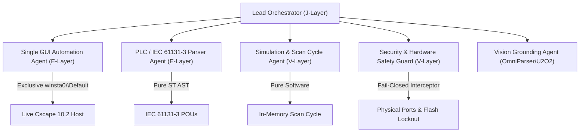

# Specialized Autonomous Agents Guide: JEV Cscape Agent

## 1. Multi-Agent Architecture (JEV Hierarchy)



---

## 2. Agent Roles and Boundaries

### 1. Lead Orchestrator (Jerarquía - J-Layer)
- **Gate Management (G0→G5)**: Governs progression across milestone gates. Gate closure requires deterministic deliverables and verifiable logs.
  - **Gate G0**: Cscape 10.2 x86 PE binary (Build 10.2.751.4), DLL exports, and registry verified.
  - **Gate G1**: False successes eliminated, modal dialog sweepers active, honest PARTIAL reporting.
  - **Gate G2**: Live Cscape visible GUI on `winsta0\Default` with project and Project Navigator active.
  - **Gate G3**: Live GUI Error Check (`32826`) clean compile (0 errors, 0 warnings), download lockout (`32827`/`33149`).
  - **Gate G4**: Pure-software closed-loop plant simulation.
  - **Gate G5**: Cryptographic audit and delivery manifest verification.
- **Contract Enforcement**: Enforces strict 4-state returns (`success | failed | blocked | inconclusive`). Subjective statuses like `VERIFIED` or `100%` are strictly forbidden.
- **Execution Watchdog**: Enforces 10-minute maximum runtime on any single command or step.

### 2. Single GUI Automation Agent (Ejecución - E-Layer)
- **Exclusive Handle Ownership**: Exactly **ONE** process or agent may interact with Cscape window handles (`HWND`) on the interactive desktop (`winsta0\Default`).
- **Interactive Desktop Mandate**: Cscape must remain open and visible on `winsta0\Default`. Headless execution for all other agents and background test runners.
- **Fail-Closed State**: If Cscape is closed, minimized, or obscured, fails closed with `status: blocked` or `status: failed`. Generating synthetic HWND success is strictly forbidden.

### 3. PLC / IEC 61131-3 Agent (Ejecución - E-Layer)
- **Pure Structured Text Parser**: Validates `.st` POUs according to IEC 61131-3 standards.
- **Forbidden Ladder Interception**: Any ladder logic contacts (`---[ ]---`), coils (`---( )---`), rung delimiters (`RUNG`, `NETWORK`), or mnemonics (`XIC`, `OTE`) are rejected immediately with `ERR_LADDER_FORBIDDEN`.
- **ST→LD Native Impossibility**: Acknowledges that Cscape 10.2 does not support in-GUI ST-to-Ladder conversion (`BLOCKED_NATIVE: DOCUMENT_ONLY`).

### 4. Security & Safety Guard Agent (Validación - V-Layer)
- **Physical Port Lockout**: Hard blocks access to `COM1`–`COM256`, `\\.\COM*`, `/dev/tty*`, `CAN*`, `USB*`, and `JTAG`.
- **Companion Flashing Binary Lockout**: Prohibits execution of `PGMUpdateUtility.exe`, `DfuSeCommand.exe`, `STMFlashLoader.exe`, and `WinJTAG.exe`.
- **Win32 Download Command Lockout**: Intercepts and blocks `ID_PROGRAM_DOWNLOAD` (`32827`) and `ID_CONTROLLER_DOWNLOAD` (`33149`).
- **Git Push Lockout**: Enforces local-only Git tracking; zero remotes configured.

### 5. Vision Grounding Agent (Optional / Vision-Layer)
- **OmniParser / U2O2 Grounding**: Employs computer vision models to parse Cscape GUI panes, status bars, and docking windows when UIAutomation accessibility nodes are unexposed or nested inside MFC controls.

---

## 3. Strict 4-State Engineering Contract

Every subagent response and tool execution payload must strictly return:
```json
{
  "status": "success | failed | blocked | inconclusive",
  "error_code": "STRING_OR_NULL",
  "details": "Factual description of outcome",
  "data": {}
}
```
- **`success`**: Assertions passed deterministically, valid deliverables created, and verifiable evidence logged.
- **`failed`**: Execution failed due to syntax error, ladder construct injection, or compile failure.
- **`blocked`**: Action prevented by safety policy (hardware download ban, COM port ban) or platform limitation (`BLOCKED_NATIVE`).
- **`inconclusive`**: Preconditions unverified or outcome cannot be validated deterministically.
