# Architecture Overview: JEV Cscape Agent

**Document Classification**: TECHNICAL SPECIFICATION & ARCHITECTURE REFERENCE  
**System Target**: Horner APG Cscape 10.2 (Build 10.2.751.4, x86 32-bit PE)  
**Safety Classification**: FAIL-CLOSED AIR-GAPPED CONTROL SYSTEM  
**Applicable Gates**: Gate G0 through Gate G12  

---

## 1. Executive Summary & Architectural Philosophy

The **JEV Cscape Agent** is an autonomous, fail-closed automation, simulation, and verification platform designed specifically for industrial control applications using **Horner APG Cscape 10.2**. Industrial programmable logic controllers (PLCs) control physical plant machinery—including high-pressure vessels, pumps, heating elements, and safety valves—where runtime errors or unauthorized code downloads can lead to catastrophic hardware damage or personnel injury.

To ensure deterministic reliability, zero false successes, and absolute hardware safety, the architecture is partitioned into three rigorous layers:
- **Jerarquía (J-Layer)**: High-level orchestration, gate progression management (G0 through G12), execution timeouts, and contract enforcement.
- **Ejecución (E-Layer)**: Single-instance interactive GUI automation on `winsta0\Default` and IEC 61131-3 Structured Text (ST) abstract syntax tree (AST) compilation.
- **Validación (V-Layer)**: Pure-software deterministic scan cycle simulation, mathematical plant modeling, vision grounding, and fail-closed security guards.

```
       +-----------------------------------------------------------+
       |             LEAD ORCHESTRATOR (J-LAYER)                   |
       |  - Milestone Gates (G0 -> G12)     - 10-Min Step Watchdog |
       |  - Contract Enforcement            - Ops Backlog & Ledger  |
       +-----------------------------+-----------------------------+
                                     |
             +-----------------------+-----------------------+
             |                                               |
             v                                               v
+-----------------------------+             +-------------------------------+
|     EJECUCIÓN (E-LAYER)     |             |      VALIDACIÓN (V-LAYER)     |
|                             |             |                               |
| [Single GUI Automation]     |             | [Simulation & Scan Engine]    |
|  - Exclusive winsta0\Default|             |  - 100% In-Memory Emulation   |
|  - File-Backed Mutex Lock   |             |  - Double-Buffered Registers  |
|  - ListBox 372 Scraper      |             |  - Zero IEEE 754 Drift        |
|  - Dialog Sweeper (#32770)  |             |                               |
|                             |             | [Security & Safety Guard]     |
| [PLC / IEC 61131-3 Parser]  |             |  - COM/CAN/USB/JTAG Lockout   |
|  - Pure Structured Text AST |             |  - Flash Binary Ban           |
|  - Ladder Rejection Guard   |             |  - Win32 Download Interceptor |
|  - BLOCKED_NATIVE ST->LD    |             |  - SHA-256 Root Ledger Audit  |
+-----------------------------+             |                               |
             |                              | [Vision Grounding Engine]     |
             v                              |  - OmniParser / U2O2 Grounding|
+-----------------------------+             |  - MFC Coordinate Fallbacks   |
|     LIVE CSCAPE 10.2        |             |  - Contrast & Bounding Box    |
| (Build 10.2.751.4, x86 PE)  |             +-------------------------------+
+-----------------------------+
```

---

## 2. The Jerarquía / Ejecución / Validación (J/E/V) Multi-Agent Model

The multi-agent hierarchy enforces strict separation of concerns, eliminating cross-agent race conditions, synthetic HWND generation, and unverified execution claims.

### 2.1 Complete Multi-Agent Hierarchy Diagram

```mermaid
graph TD
    subgraph JLayer ["Jerarquía (J-Layer): Governance & Orchestration"]
        Orch["Lead Orchestrator<br/>(Gate Governor G0..G12 & Backlog Monitor)"]
        ContractEng["Contract Enforcement Engine<br/>(Strict 4-State Envelope Validator)"]
        Watchdog["Step Execution Watchdog<br/>(10-Minute Hard Ceiling)"]
    end

    subgraph ELayer ["Ejecución (E-Layer): Deterministic Action & Parsing"]
        WinAuto["Single GUI Automation Agent<br/>(Exclusive Mutex & Window Controller)"]
        Sweeper["Modal Dialog Sweeper<br/>(Tip of the Day & #32770 Handler)"]
        Scraper["Output Scraper<br/>(MFC ListBox 372 Diagnostics)"]
        PLCIEC["PLC / IEC 61131-3 Parser Agent<br/>(AST Engine & Syntax Validator)"]
    end

    subgraph VLayer ["Validación (V-Layer): Simulation, Safety & Vision"]
        SimAgent["Simulation & Scan Cycle Agent<br/>(Zero-Drift Scan Engine)"]
        PlantMod["Plant Process Model<br/>(Two-Tank Non-Linear Cascade)"]
        SecGuard["Security & Commissioning Guard<br/>(Zero-Trust Port & Flash Interceptor)"]
        ManifestAudit["Cryptographic Manifest Manager<br/>(SHA-256 Root Digest Verifier)"]
        VisionAgent["Vision Grounding Agent<br/>(OmniParser / U2O2 Fallback)"]
    end

    subgraph TargetSystem ["Target Environment & Hardware Boundaries"]
        InteractiveDesktop["winsta0\\Default<br/>Interactive Windows Station"]
        CscapeExe["Live Cscape 10.2 Host<br/>(HWND 0x67090c, PID 1076)"]
        PhysicalPorts["Physical Hardware Interfaces<br/>(COM1..COM256, CAN, USB, JTAG)"]
        FlashBinaries["Companion Flashing Utilities<br/>(PGMUpdateUtility, DfuSeCommand)"]
    end

    %% J-Layer Orchestration Connections
    Orch --> ContractEng
    Orch --> Watchdog
    Orch -->|"Directs Automation"| WinAuto
    Orch -->|"Submits ST Source"| PLCIEC
    Orch -->|"Triggers Scan Cycles"| SimAgent
    Orch -->|"Enforces Safety Policy"| SecGuard
    Orch -->|"Queries UI Layout"| VisionAgent

    %% E-Layer Execution Connections
    WinAuto --> Sweeper
    WinAuto --> Scraper
    WinAuto -->|"Exclusive Mutex Lock"| InteractiveDesktop
    InteractiveDesktop --> CscapeExe
    PLCIEC -.->|"BLOCKED_NATIVE (Document Only)"| CscapeExe

    %% V-Layer Validation Connections
    SimAgent --> PlantMod
    SecGuard --> ManifestAudit
    SecGuard -->|"HARD LOCKOUT (FAIL-CLOSED)"| PhysicalPorts
    SecGuard -->|"EXECUTION INTERCEPTED"| FlashBinaries
    VisionAgent -.->|"GDI / OCR Coordinate Mapping"| CscapeExe
```



---

## 3. Detailed Agent Roles and Boundaries

### 3.1 Lead Orchestrator (Jerarquía - J-Layer)
- **Gate Management (G0 through G12)**: Governs step-by-step gate promotion according to deterministic milestone deliverables:
  - **Gate G0**: Host forensics, Cscape 10.2 PE verification (Build 10.2.751.4), zero secrets, and CLI scaffolding.
  - **Gate G1**: Elimination of false success hypotheses H01–H13, modal sweeper activation, navigation map, and pure ST parser verification.
  - **Gate G2**: Exclusive single-GUI control on `winsta0\Default`, Project Navigator (`SysTreeView32`, ID 300) UIA tree traversal.
  - **Gate G3**: Live GUI Error Check (`ID_PROGRAM_ERRORCHECK = 32826`) clean compile (0 errors, 0 warnings), ListBox 372 scraping, and download lockout.
  - **Gate G4**: Pure-software closed-loop plant simulation across 5 canonical scenarios under offline mock mode (`BLK-001`).
  - **Gate G5**: Cryptographic SHA-256 delivery manifest and 6-stage air-gapped verification bundle.
  - **Gate G6**: FastMCP protocol parity with 16 canonical tools and zero external MCP runtime dependencies.
  - **Gate G7**: Two-tank cascade non-linear physical plant model with stochastic Ornstein-Uhlenbeck drift and load stepping.
  - **Gate G8**: Modbus telemetry scaling bridge, Namur NE43 monitoring, and OPC UA quality word flags.
  - **Gate G9**: Vision grounding engine with 5-region workspace segmentation and unexposed MFC control fallbacks.
  - **Gate G10**: Multi-rate closed-loop 100,000-cycle soak verification with zero memory leak and 0.0000% steady-state error.
  - **Gate G11**: Exhaustive pre-commissioning safety lockout audit across ports, binaries, Win32 commands, and remotes.
  - **Gate G12**: Field commissioning fail-closed hardware barrier formalization (`ops/commissioning_lockout.json`).
- **Contract Enforcement**: Rejects non-conforming responses. Subjective claims (`VERIFIED`, `100% SUCCESS`, `COMPLETE`) are strictly forbidden.
- **Execution Watchdog**: Enforces a strict 10-minute maximum runtime on any single command or step.

### 3.2 Single GUI Automation Agent (Ejecución - E-Layer)
- **Exclusive Handle Ownership**: Exactly **one** process may interact with Cscape window handles (`HWND`) on the interactive desktop (`winsta0\Default`) at any time. A file-backed mutex (`work/disposable/gui_boundary.lock`) guarantees mutual exclusion.
- **Interactive Desktop Mandate**: Cscape must remain open, restored, and visible on `winsta0\Default`. Headless execution or window generation in disconnected sessions (Session 0) is prohibited.
- **Fail-Closed State**: If Cscape is closed, minimized, obscured, or unresponsive, the agent fails closed with `status: blocked` or `status: failed`. Generating synthetic HWND success is strictly forbidden.
- **Output Scraping**: Scrapes compilation results directly from the MFC ListBox (Control ID `372`) nested within the dockable Output Window (Control ID `45011`) using `LB_GETCOUNT` and `LB_GETTEXT`.
- **Modal Dialog Sweeping**: Monitors for blocking MFC dialogs (`#32770`), including "Tip of the Day" and compilation result modals, dismissing them automatically to prevent UI lockup.

### 3.3 PLC / IEC 61131-3 Parser Agent (Ejecución - E-Layer)
- **Pure Structured Text Parser**: Validates `.st` program organization units (POUs) against IEC 61131-3 grammar rules. Extracts:
  - POU Type: `PROGRAM`, `FUNCTION_BLOCK`, `FUNCTION`.
  - Variable Scopes: `VAR`, `VAR_INPUT`, `VAR_OUTPUT`, `VAR_IN_OUT`, `VAR_GLOBAL`, `VAR_TEMP`.
  - Memory Bindings: OCS registers (`%R`, `%I`, `%Q`, `%M`, `%AI`, `%AQ`).
- **Forbidden Ladder Interception**: Any ladder logic contacts (`---[ ]---`), coils (`---( )---`), rung delimiters (`RUNG`, `NETWORK`), or mnemonics (`XIC`, `OTE`) are rejected immediately with `ERR_LADDER_FORBIDDEN`.
- **ST->LD Native Impossibility**: Formally acknowledges that Cscape 10.2 lacks an internal compiler mechanism for translating Structured Text into Ladder Logic. Marked permanently as `BLOCKED_NATIVE: DOCUMENT_ONLY`.

### 3.4 Simulation & Scan Cycle Agent (Validación - V-Layer)
- **Deterministic Virtual Clock**: Uses 64-bit integer microsecond accumulation (`_elapsed_us`) to advance discrete scan cycles with zero IEEE 754 floating-point drift over millions of iterations.
- **Double-Buffered Register Memory**: Implements exact Horner OCS 14-channel register spaces (`%R`, `%AI`, `%AQ`, `%I`, `%Q`, `%M`, `%D`, `%K`, `%S`, `%SR`, `%IG`, `%QG`, `%AIG`, `%AQG`) with 16-bit word and 1-bit discrete alignment.
- **Plant Process Emulation**: Integrates continuous non-linear models:
  - First-principles single-tank model with Torricelli discharge and valve slew rate limits.
  - Two-tank cascade system (`TwoTankCascadeModel`) with inter-tank gravity flow, non-negative volume constraints, Ornstein-Uhlenbeck stochastic drift, and Poisson load disturbance.
- **Standard Function Blocks**: Emulates IEC 61131-3 timers (`TON`, `TOF`, `TP`) and counters (`CTU`, `CTD`, `CTUD`) with cycle-accurate behavior.

### 3.5 Security & Commissioning Guard Agent (Validación - V-Layer)
- **Physical Port Lockout**: Prohibits opening or binding to serial ports `COM1` through `COM256`, Windows namespaces `\\.\COM*`, Linux namespaces `/dev/tty*`, CAN interfaces `CAN*`, USB interfaces `USB*`, or JTAG headers `JTAG*`.
- **Companion Flashing Binary Lockout**: Blocks execution of companion utilities `PGMUpdateUtility.exe`, `DfuSeCommand.exe`, `STMFlashLoader.exe`, and `WinJTAG.exe`.
- **Win32 Command Interception**: Intercepts `ID_PROGRAM_DOWNLOAD` (`32827`) and `ID_CONTROLLER_DOWNLOAD` (`33149`), raising `HardwareLockoutError` / `CommissioningLockedError`.
- **Local-Only Git Tracking**: Enforces zero remotes in Git configuration; remote push operations are blocked to prevent external exposure.
- **Cryptographic Audit Ledger**: Computes deterministic SHA-256 digests across all repository deliverables, generating a Merkle-style root digest.

### 3.6 Vision Grounding Agent (Validación - Vision-Layer)
- **OmniParser / U2O2 Grounding**: Segments the Cscape 10.2 window workspace into 5 canonical visual regions:
  1. Top Ribbon / Menu Bar (MFC ControlBar top pane).
  2. Project Navigator Dock Pane (`SysTreeView32` inside `Afx:ControlBar`).
  3. Output Window Dock Pane (ListBox `372` inside `Afx:ControlBar`).
  4. Central Ladder/ST Editor Viewport (MDI Client canvas).
  5. Status Bar (`msctls_statusbar32`).
- **Contrast & Visibility Metrics**: Calculates WCAG luminance contrast ratios and RMS contrast across segmented panes to detect collapsed or obscured windows.
- **Fallback MFC Coordinates**: Provides deterministic fallback click targets for 23 unexposed MFC control IDs when Windows UIAutomation (UIA) tree traversal is blocked by custom owner-drawn MFC controls.

---

## 4. FastMCP Protocol Parity Architecture

Work Package **W025 (Gate G6)** provides full **Model Context Protocol (MCP)** tool execution and server capability without relying on any external runtime dependencies.

### 4.1 Zero-Dependency Clean Room Design

1. **Zero External MCP Imports**: The server and registry are built using standard Python standard library modules (`json`, `sys`, `typing`, `logging`, `io`) and `pydantic`. The external `mcp` library is **never** imported.
2. **Absolute Clean Room Isolation**: Zero imports or code references to legacy external repositories (e.g., `horner-cscape-mcp`). All handlers map directly to local modules in `jev_cscape`.
3. **Transport Layer**: Implements a lightweight `run_stdio()` streaming processor reading line-delimited JSON-RPC 2.0 messages from standard input (`sys.stdin`) and emitting responses to standard output (`sys.stdout`).
4. **Standard JSON-RPC 2.0 Error Codes**:
   - `-32700`: Parse error (invalid JSON string).
   - `-32600`: Invalid Request (missing `jsonrpc: "2.0"` or invalid method).
   - `-32601`: Method not found (unknown RPC endpoint).
   - `-32602`: Invalid params (parameters failing schema validation).
   - `-32603`: Internal error (unhandled execution exception).

### 4.2 The 16 Canonical Gate G6 Tools

| # | Tool Identifier | Architectural Layer | Operational Purpose | Strict Contract Guard / Failure Mode |
|---|---|---|---|---|
| 1 | `cscape_doctor` | Environment | Verifies OS platform, Python version, Cscape executable path, and safety locks | `CSCAPE_EXE_NOT_FOUND` if executable absent |
| 2 | `cscape_status` | Orchestration | Retrieves active gate milestones (`G0..G12`) and operational backlog | Always succeeds with structured milestone ledger |
| 3 | `gui_inspect` | GUI Automation | Probes Cscape main window HWND and modal popups on `winsta0\Default` | Fail-closed (`CSCAPE_NOT_RUNNING`) if process missing |
| 4 | `gui_launch` | GUI Automation | Launches Cscape 10.2 within interactive session with optional project | Blocks on prohibited switches (`FAIL_CLOSED_HARDWARE_LOCKOUT`) |
| 5 | `gui_close` | GUI Automation | Cleanly closes running Cscape process via `WM_CLOSE` | Returns teardown status; fails if process unresponsive |
| 6 | `gui_sweep_dialogs` | GUI Automation | Detects and dismisses modal dialogs (`#32770`, Tip of the Day) | Audits and logs dismissed window handles |
| 7 | `gui_inspect_navigator` | GUI Automation | Inspects Cscape Project Navigator pane (`SysTreeView32`, ID 300) | Traverses observed UIA tree nodes without synthetic IDs |
| 8 | `gui_compile_error_check` | GUI Automation | Dispatches `ID_PROGRAM_ERRORCHECK` (`32826`) clean compile check | Scrapes 0 errors / 0 warnings; dismisses completion modal |
| 9 | `gui_scrape_output` | GUI Automation | Scrapes diagnostic text from MFC ListBox (`372`) in Output Window (`45011`) | Parses line count and error/warning counts |
| 10 | `iec_validate_st` | IEC 61131-3 | Validates pure Structured Text AST and rejects ladder constructs | Fails closed on ladder with `ERR_LADDER_FORBIDDEN` |
| 11 | `iec_convert_st_to_ladder` | IEC 61131-3 | Translates Structured Text to Ladder logic in Cscape | Permanently blocked (`BLOCKED_NATIVE: DOCUMENT_ONLY`) |
| 12 | `sim_run_scan_cycles` | Simulation | Executes deterministic in-memory scan cycle simulation engine | Returns virtual elapsed time & cycle telemetry |
| 13 | `sim_verify_closed_loop` | Simulation | Runs closed-loop validation matrix across the 5 canonical scenarios | Verifies setpoint regulation & ESD de-energization |
| 14 | `sim_inspect_registers` | Simulation | Inspects Horner OCS register space (`%R`, `%I`, `%Q`, `%AI`, `%AQ`, `%SR`, `%S`) | Formats structured register values |
| 15 | `security_audit_guard` | Safety Guard | Audits fail-closed locks on COM ports, flasher tools, and download commands | Probed targets return `FAIL_CLOSED_*` |
| 16 | `security_verify_manifest` | Security Guard | Verifies cryptographic SHA-256 delivery manifest across artifacts | Reports `MANIFEST_VERIFICATION_FAILED` if tampered |

---

## 5. Strict 4-State Engineering Contract

Every tool execution, subagent interaction, and CLI command returns an immutable `ExecutionResult` envelope conforming to the strict 4-state engineering contract:

```json
{
  "status": "success | failed | blocked | inconclusive",
  "error_code": "STRING_OR_NULL",
  "details": "Factual, verifiable description of outcome",
  "data": {}
}
```

### 5.1 Contract State Definitions

1. **`success`**:
   - Assertions passed deterministically.
   - Deliverable artifacts created and cryptographically verified on disk.
   - Zero errors and zero warnings logged.
2. **`failed`**:
   - Execution terminated due to a deterministic failure (syntax violation, compile error, assertion breakdown).
   - Specific, non-null `error_code` provided (e.g., `ERR_LADDER_FORBIDDEN`, `COMPILE_ERROR_CHECK_FAILED`).
3. **`blocked`**:
   - Operation prevented by a mandatory safety guard (hardware download lockout, physical port access attempt) or a permanent architectural limitation (`BLOCKED_NATIVE: DOCUMENT_ONLY`).
   - Specific, non-null `error_code` provided (e.g., `ERR_COMMISSIONING_LOCKED`, `FAIL_CLOSED_HARDWARE_LOCKOUT`).
4. **`inconclusive`**:
   - Preconditions unverified or runtime environment indeterminate.
   - Used when evidence cannot be acquired deterministically without side effects.

### 5.2 Elimination of False Successes (H01 through H13)

During Gate G1, thirteen potential false-success failure modes were dismantled:
- Hardcoded HWND recycling was replaced with dynamic Win32 enumeration.
- Silent mock substitution was eliminated; mocks are restricted to `SimulationBackend.EMULATED` under explicit flag.
- Invented UIAutomation `AutomationId` values were eradicated in favor of observed `SysTreeView32` handle walking.
- Ambiguous exit codes were replaced with structured JSON payloads.

---

## 6. Fail-Closed Hardware Lockouts & Operational Boundaries

```
[Agent Action Initiated]
        |
        v
+-------------------------------+
|    SecurityGuard Interceptor  |
+-------------------------------+
        |
        +---> [Target: COM1..COM256 / CAN / USB / JTAG] ----> RAISE HardwareLockoutError (BLOCKED)
        |
        +---> [Target: PGMUpdateUtility / DfuSeCommand]   ----> RAISE HardwareLockoutError (BLOCKED)
        |
        +---> [Target: WM_COMMAND 32827 / 33149]        ----> RAISE HardwareLockoutError (BLOCKED)
        |
        +---> [Target: CLI Switch /download /flash]     ----> RAISE HardwareLockoutError (BLOCKED)
        |
        +---> [Target: ST-to-Ladder Translation]        ----> RAISE BlockedNativeError   (BLOCKED)
        |
        v
[Action Permitted (In-Memory / Read-Only / Error Check 32826)]
```

### 6.1 Hardware Port Isolation
- All access to physical serial ports (`COM1` through `COM256`), device namespaces (`\\.\COM*`, `/dev/tty*`), fieldbuses (`CAN*`), USB interfaces (`USB*`), and JTAG interfaces (`JTAG*`) is intercepted and rejected with `HardwareLockoutError`.

### 6.2 Companion Flasher Prohibition
- Execution of external flashing binaries (`PGMUpdateUtility.exe`, `DfuSeCommand.exe`, `STMFlashLoader.exe`, `WinJTAG.exe`) is intercepted at process initiation.

### 6.3 Win32 Download Interception
- Cscape's internal Win32 menu commands for controller programming (`ID_PROGRAM_DOWNLOAD = 32827` and `ID_CONTROLLER_DOWNLOAD = 33149`) are intercepted by `Win32CommandInterceptor`.
- Compilation verification relies strictly on `ID_PROGRAM_ERRORCHECK = 32826` (Ctrl+F7), which compiles ladder and ST logic into memory without broadcasting packets over serial or network ports.

### 6.4 ST-to-Ladder Native Barrier
- In Cscape 10.2, Structured Text POUs exist as standalone program organization units. The software does not provide an automated compiler pass to convert Structured Text into Ladder Logic rungs. Attempts to trigger automated conversion return `status: blocked` with `error_code: BLOCKED_NATIVE`.

---

## 7. Air-Gapped Verification & Manifest Integrity

All production artifacts are sealed within an air-gapped cryptographic bundle governed by `src/jev_cscape/security/manifest.py`.

1. **SHA-256 Digest Ledger**: Every deliverable across gates G0 through G12 is hashed using SHA-256.
2. **Merkle-Style Root Digest**:
   $$H_{\text{gate}} = \text{SHA-256}\left(\sum_{i \in \text{gate}} \text{Sort}(H_i)\right)$$
   $$H_{\text{root}} = \text{SHA-256}\left(\sum_{i \in \text{all}} \text{Sort}(H_i)\right)$$
3. **Tamper Rejection**: Any modified, truncated, or extraneous file causes `ManifestManager.verify_manifest()` to fail closed, returning detailed diff logs and preventing gate closure.
