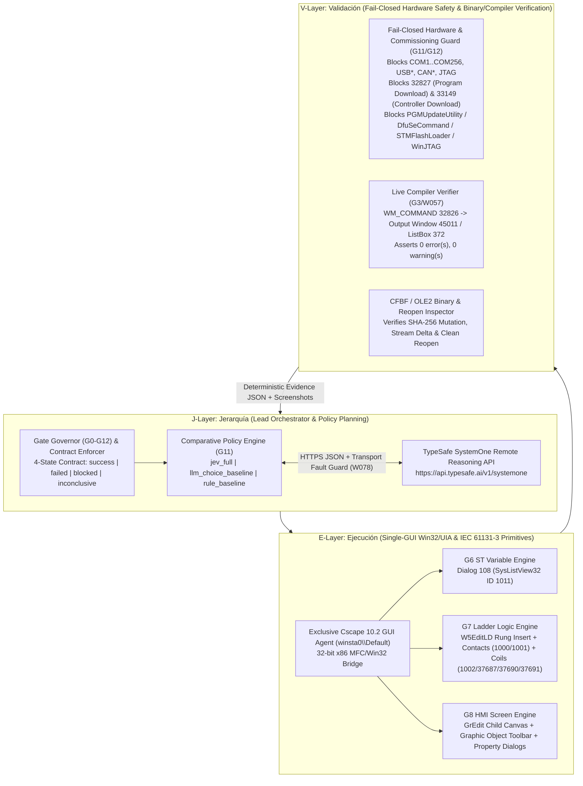

# W093: Horner APG Technical Dossier — Architecture, Capability Matrix, Evidence Index & Engineering Collaboration

## 1. JEV 3-Layer Autonomous Architecture (`J-Layer` / `E-Layer` / `V-Layer`)

---

## 2. Certified Capability Matrix (`G0`–`G11`)

| Capability Family | Primary Gate | Certified Mechanism in Cscape 10.2 (Build `10.2.751.4`) | Live Verification Pass Rate | Median / p95 Trial Latency (G11 `jev_full`) |
| :--- | :--- | :--- | :--- | :--- |
| **IEC / ST Variable Declarations (`st_var`)** | `G3` / `G6` / `G11` | Program Variables Window (`33746`) $\rightarrow$ Dialog `108` (`SysListView32` ID `1011`) in-place `Edit` cell injection (`Name`, `Type`, `Attribute`, `Address`) + `WM_COMMAND 32826` Error Check + `ID_FILE_SAVE` (`57603`) + CFBF binary verification. | **G6**: `10/10` (`100%`) **G11 Benchmark**: `90/90` (`100%` across all 3 policies) **G11 W088**: `78/78` (`100%`) | Median: `49,475.3 ms` p95: `57,911.2 ms` |
| **Ladder Logic Contacts & Coils (`ladder`)** | `G7` / `G8` / `G11` | `TagDatabase` registration + `W5EditLD` rung insertion + toolbar/command placement of NO Contact (`1000`), NC Contact (`1001`), NO Coil (`1002`), NC Coil (`37687`), Set Coil (`37690`), Reset Coil (`37691`) + operand binding + `WM_COMMAND 32826` Error Check (`0 errors, 0 warnings`). | **G7**: `19/20` (`95.0%`) **G11 Benchmark**: `89/90` (`98.9%`, `LADDER_19` healed in `f218227`) **G11 W088**: `76/76` (`100%`) | Median: `61,686.2 ms` p95: `66,548.7 ms` |
| **HMI Screen Editor Objects (`hmi`)** | `G8` / `G11` | `View/Edit Screens` (`32802`) $\rightarrow$ `GrEdit` MDI canvas (`AfxFrameOrView140` + `ToolbarWindow32` ID `59422` `"Graphic Object"`) placement of `Numeric Data`, `Lamp / Indicator`, `Switch / Pushbutton`, `Bar Graph / Gauge`, `Static Text Legend` + property dialog dismissal + `CFBF control_count delta >= 2`. | **G8**: `20/20` (`100%`) **G11 Benchmark**: `90/90` (`100%` across all 3 policies) **G11 W088**: `75/75` (`100%`) | Median: `72,291.5 ms` p95: `99,733.6 ms` |
| **End-to-End Parameterized Workflows** | `G9` | 10 industrial automation workflows combining live TypeSafe SystemOne planning, corpus retrieval, Cscape mutation, Error Check (`32826`), save, and reopen; plus explicit `PENDING_CONFIRMATION` guard blocking destructive Task 06. | **G9**: `8/8` standard passed + `1` negative handled + `1` pending confirmation guard (`10/10` handled) | Mean E2E: `~24.1 s` |
| **Negative Fault-Injection & Crash Recovery** | `G10` | 28 live scenarios across `W078` (HTTP transport timeouts/503/429/malformed JSON around real API calls), `W079` (process kill mid-save & post-commit with real SHA mutation), `W080` (corrupt `.csp` header, zero-byte file, locked file, missing directory), and `W081` (modal sweeps, disabled controls, coordinates). | **G10**: `28/28` (`100%` handled) Recoverable: `16/16` (`100.0%` $\ge 90\%$) Unrecoverable: `12/12` (`6` abstain + `6` pause) | Real Cscape PIDs & HTTP statuses logged per scenario |
| **Comparative Policy Benchmark & 4h Endurance** | `G11` | 90 unseen tasks (`30 ladder`, `30 hmi`, `30 st_var`) $\times$ 3 policies (`jev_full`, `rule_baseline`, `llm_choice_baseline`) = `270` benchmark trials + `229` W088 endurance trials (`4.0h` live run, `22` controlled worker restarts, `0` corruptions). | **Benchmark**: `269/270` (`99.63%`, `270/270` unique tasks verified) **Endurance (4h)**: `229/229` (`100.0%`) **Total**: `498/499` (`99.80%`) | Combined API Calls: `333` Combined Tokens: `340,932` Combined Cost: `$0.765440` |
| **Hardware Safety & Commissioning Lockout** | `G0` / `G3` / `G11` / `G12` | Fail-closed interception of `COM1`–`COM256`, `USB*`, `CAN*`, `JTAG`, companion flashers (`PGMUpdateUtility.exe`, `DfuSeCommand.exe`, `STMFlashLoader.exe`, `WinJTAG.exe`), and Win32 download IDs (`32827`, `33149`). | `100%` fail-closed (`G12_bank=blocked`) | Deterministic `< 1 ms` interception |

---

## 3. Gate Evidence Index (`G0`–`G11`)

All 16 primary evidence artifacts are stored in `artifacts/` and verified by [`scripts/g12_release_campaign.py`](../../scripts/g12_release_campaign.py):

| Gate | Primary Artifact Path | Size (Bytes) | SHA-256 Digest | Certified Verdict / Summary |
| :--- | :--- | ---: | :--- | :--- |
| **G0–G4** | `artifacts/gate_report.json` | `21,871` | `e68584ff69c82c844b63d8f7a3d0d82b1efdc80378838c4cd6a40dacf645d0ae` | G0–G4 PE headers, DLL exports, flash lockout & gate ledger |
| **G1** | `artifacts/G1/channel_matrix.json` | `2,483` | `ef0ad4106b58afa114e2a87cd55cb790da32f327d556eb83422050da76a78254` | Synthetic successes eliminated; 4-state contract & channel matrix |
| **G2** | `artifacts/G2/navigator_inspection.json` | `2,286` | `63c02b8227cd4448c4caf7af4651bd0821485780bc554b0aedfbe5c7e8b4f5d1` | Live `winsta0\Default` Cscape Project Navigator hierarchy mapped |
| **G2** | `artifacts/G2/single_gui_boundary_evidence.json` | `757` | `b2af1c000d93e0374d707add3cc3f1acae3f1ed1fbd85bb0d509a11ab6417275` | Single-GUI handle ownership boundary verified |
| **G3** | `artifacts/G3/g3_campaign_summary.json` | `8,378` | `5f0b001b95d74844710939cb87a6184bf559b530bb9bac794a866ae823b253ce` | Clean Error Check (`32826`) & durability runs verified |
| **G3** | `artifacts/G3/error_check_evidence.json` | `12,122` | `7967faf573c128eb1717853e29d34654cc73cb5464f645f3e60a59258775739f` | Compiler Output Window (`45011` / `ListBox 372`) `0 errors, 0 warnings` |
| **G4** | `artifacts/G4/g4_campaign_summary.json` | `31,091` | `2f62804a255b02867afbf5ef39a9618e176822b32c9e41bf60b0ace7b0fea4eb` | Closed-loop plant simulation & live TypeSafe SystemOne reasoning |
| **G5** | `artifacts/G5/delivery_manifest.json` | `176,247` | `1bdcea1ce6b8d036b356569803ddb317c98c0a58baca3bba1f53e74924482c52` | Cryptographic delivery manifest & air-gapped bundle signoff |
| **G5** | `artifacts/G5/g5_live_campaign_summary.json` | `8,840` | `b2e18f7098c04d844325c5e9610231ce098f1661be902b2b5558a4d231b13b79` | Gate G5 live verification summary |
| **G6** | `artifacts/G6/g6_acceptance_evidence.json` | `30,881` | `c59feb2f0c5f9708b299ee6591b91be88250c51912fc6e69c88a81f967666d4b` | ST variable declaration (`10/10` positive + negative controls) |
| **G7** | `artifacts/G7/g7_acceptance_summary.json` | `36,403` | `ec4ade178b1f5bca372737ba0d5044487630e1b5bdb55b28d70cb5e361d1de8b` | Ladder logic live placement: `19/20` (`95.0%` $\ge 85\%$) |
| **G8** | `artifacts/G8/g8_campaign_summary.json` | `16,457` | `2a525f5bbe19394c16cbd484e41535386b42441c4269a0998261e053f7a59327` | HMI screen object placement campaign: `20/20` (`100.0%`) |
| **G9** | `artifacts/G9/g9_campaign_summary.json` | `71,754` | `30c5570be3dc929c3041c753cf08acba4df78e1fb808682f9fda9c0d70115400` | End-to-end 10 parameterized workflows (`0` failed, Task 06 pending guard) |
| **G10** | `artifacts/G10/g10_campaign_summary.json` | `67,193` | `5744f6639d5ac9f34318676dd5a93f17ef6b973c1ed3f9d474a9290ec44ed20a` | 28 fault scenarios: `16/16` (`100%`) recoverable, `12/12` unrecoverable |
| **G11** | `artifacts/G11/g11_results.json` | `599,622` | `f79cd35f0eac3c094de594d0fd1fa52bd667c53885e714bd21a36c7a96b3759d` | `229/229` (`100%`) 4.0h W088 endurance + `269/270` benchmark (`270/270` verified) |
| **G11** | `artifacts/G11/g11_acceptance.txt` | `9,604` | `c8f78fa336fca4127ea8203028c830896e0b20dfadbdc3daaedbe9479c3983f1` | `OVERALL GATE G11 ACCEPTANCE VERDICT: PASS` |

---

## 4. Technical Collaboration Questions for Horner APG Engineering (W093)

Based on empirical Win32/UIA and CFBF binary forensics conducted across Gates `G0`–`G11` on **Cscape 10.2 (Build `10.2.751.4`)**, we propose the following 6 concrete engineering collaboration topics for Horner APG's desktop and firmware teams:

### Q1. Headless CLI Compiler & Syntax Verification Switch (`K5Cmp.dll` / `Cscape.exe`)
- **Current Observation**: Triggering an IEC/Ladder Error Check requires launching the full 32-bit MFC GUI on `winsta0\Default`, dispatching `WM_COMMAND 32826` (`Ctrl+F7`), and scraping `ListBox` ID `372` inside Dockable Output Pane `ID 45011`.
- **Question for Horner APG**: Can Horner expose a non-interactive CLI flag (e.g., `Cscape.exe /compile "project.csp" /out "diagnostics.json"`) or document the direct C-ABI entrypoints in `K5Cmp.dll` / `K5MW.dll` so CI/CD pipelines and autonomous agents can run syntax/compile checks headlessly without an active `winsta0\Default` desktop session?

### Q2. Programmatic Text & AST Access for `W5EditST.dll`
- **Current Observation**: The `W5EditSt` editor window class renders Structured Text directly via owner-drawn GDI routines and returns `0` characters to `WM_GETTEXT` and Windows UIAutomation `TextPattern`, while Variable Table edits require driving Dialog `108` (`SysListView32` ID `1011`) via simulated double-click cell edits (`G6`).
- **Question for Horner APG**: Does `W5EditST.dll` support an internal custom Win32 message (`WM_USER + N`) or COM interface to read/write the active POU's Structured Text buffer and variable table directly in memory without UI coordinate clicking?

### Q3. Official Specification for `.csp` CFBF / OLE2 Stream Layout & Checksums
- **Current Observation**: Native `.csp` projects are Microsoft Compound File Binary Format (`D0 CF 11 E0 A1 B1 1A E1`) containers. While our agent safely reads stream directories and control block counts (`G7`/`G8`/`G10`) and performs all mutations through Cscape's own `ID_FILE_SAVE` (`57603`), direct offline `.csp` synthesis is prevented by undocumented internal stream CRCs and cross-stream offsets.
- **Question for Horner APG**: Would Horner share the internal stream specification (or an official SDK/serialization DLL) for `.csp` / `.cpj` containers so third-party tooling can validate or diff Ladder rungs, Tag Databases, and HMI screens offline?

### Q4. Deterministic HMI Object Property Automation in `GrEdit` (`G8` / `G11`)
- **Current Observation**: Placing HMI widgets (`Numeric Data`, `Lamp`, `Switch`, `Bar Graph`, `Static Text`) on the `GrEdit` canvas (`AfxFrameOrView140`) via `"Graphic Object"` `ToolbarWindow32` (`ID 59422`) occasionally triggers asynchronous modal property dialogs (`Numeric Data Properties`, `Legend Properties`) whose Win32 class/title lifecycle depends on cursor message queue timing (`G11` W085 remediation).
- **Question for Horner APG**: Is there a deterministic command ID or recipe import hook for instantiating and binding HMI screen objects (e.g., XML/CSV screen object import/export) that bypasses mouse drag-and-drop on the `GrEdit` canvas?

### Q5. Roadmap for Native IEC 61131-3 ST $\leftrightarrow$ Ladder Interoperability (`BLOCKED_NATIVE`)
- **Current Observation**: Export table forensics (`G0`) across `Cscape.exe`, `W5EditST.dll`, `W5EditLD.dll`, and `K5Cmp.dll` confirmed that Cscape 10.2 provides no native in-GUI conversion between Structured Text POUs and Advanced/IEC Ladder rungs (`BLOCKED_NATIVE: DOCUMENT_ONLY`).
- **Question for Horner APG**: Does Horner plan to introduce IEC 61131-3 PLCopen XML import/export or intermediate IL/FBD cross-compilation in Cscape 10.x / 11.x to allow mixed-language translation between ST and Ladder POUs?

### Q6. UIAutomation Accessibility Metadata for `SysTreeView32` & Dockable Panes
- **Current Observation**: Several MFC controls in Cscape 10.2 (including dockable panes `ID 45010` Project Navigator, `ID 45011` Output Window, and `W5EditLD` rung grids) expose legacy Win32 `HWND` messages (`TVM_GETNEXTITEM`, `LB_GETTEXT`) but lack complete Microsoft UIAutomation (`IUIAutomationElement`) `AutomationId` and `ValuePattern` providers.
- **Question for Horner APG**: Can future Cscape builds populate standard `AutomationId` and `LegacyIAccessible` properties across the Project Toolbox, Rung Editor, and Graphic Editor to simplify assistive and automated testing?
