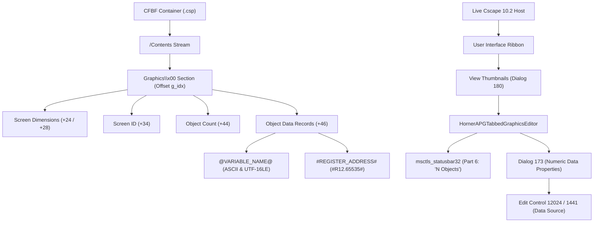

# Horner APG Cscape 10.2 HMI Graphics Schema & Property Matrix Specification

> **Target Platform**: Horner APG Cscape 10.2 (Build 10.2.751.4)  
> **Container Format**: Compound File Binary Format (CFBF / OLE2) `.csp` Project Files  
> **Origin Library**: `GrEdit.dll` (Horner APG Graphics Editor Extension)  
> **Safety Guard**: Strict Fail-Closed Hardware Barrier | Local Air-Gapped Verification  
> **Standards Conformance**: IEC 61131-3, ANSI/ISA-101.01-2015, Horner OCS Memory Model  

---

## 1. Executive Summary & Gate G8 Scope

This specification defines the exact binary schema, component metadata, and property matrix for Human-Machine Interface (HMI) screen graphics embedded within Horner APG Cscape 10.2 native CFBF project files (`.csp`). It establishes deterministic criteria for programmatic HMI object placement, variable data binding, status bar oracle verification, and persistence roundtrip validation.



---

## 2. CFBF HMI Binary Schema (`/Contents` Stream)

In Horner Cscape 10.2, HMI graphics objects and screen configuration are stored within the primary OLE2 Compound File stream named `/Contents`.

### 2.1 Graphics Section Header Layout

| Field Offset (Rel. to `g_idx`) | Type | Size (Bytes) | Description | Example Value |
| :--- | :--- | :--- | :--- | :--- |
| `+0` | `char[9]` | 9 | Section Magic (`Graphics\x00`) | `Graphics\x00` |
| `+9`..`+23` | `byte[15]` | 15 | Reserved header preamble / flags | Internal Cscape flags |
| `+24` | `uint32_le` | 4 | Screen Native Width (Pixels) | `320` (0x00000140) |
| `+28` | `uint32_le` | 4 | Screen Native Height (Pixels) | `240` (0x000000F0) |
| `+32` | `uint16_le` | 2 | Reserved screen flags | `0x0001` |
| `+34` | `uint32_le` | 4 | Screen Numeric ID | `1` (Screen 1) |
| `+38`..`+43` | `byte[6]` | 6 | Display palette and grid metrics | Grid spacing & zoom |
| `+44` | `uint8` | 1 | **Screen Placed Object Count** | `0` (base), `1`, `2`, ... |
| `+45` | `uint8` | 1 | Section sub-format byte | `0x00` / `0x01` |
| `+46` | `byte[]` | Variable | Placed HMI Object Records & Attributes | Sequential object descriptors |

### 2.2 Placed Object Record Serialization Format

Each placed object on the screen canvas serializes its bounding box, attributes, visual style, and variable binding into the record area starting at `g_idx + 46`.

```text
[Object Record Header]
  +00: uint16 Object Type Code (e.g. 0x01 = Numeric Display, 0x02 = Indicator)
  +02: int16  Left (Screen Pixels)
  +04: int16  Top (Screen Pixels)
  +06: int16  Right (Screen Pixels)
  +08: int16  Bottom (Screen Pixels)
  +10: uint16 Style / Bezel Flags
  +12: uint16 Color Attributes (Foreground / Background)
  +14: uint16 Data Format / Decimal Places / Field Width

[Variable Binding Descriptor]
  +16: uint8  Binding Type Flag (0x21 = Tag Name, 0x01 = Direct Address)
  +17: uint8  String Length N
  +18: char[N] ASCII Tag Token (e.g. "@RTC_SEC@")
  +18+N: uint8 Address Length M
  +19+N: char[M] OCS Direct Register Token (e.g. "#R12.65535#")
```

### 2.3 Variable Token Encodings in the Binary Stream

1. **Length-Prefixed ASCII Token**:
   - Format: `0x21 <len> @<VAR_NAME>@`
   - Example (`RTC_SEC`): `21 09 40 52 54 43 5f 53 45 43 40`
2. **OCS Direct Register Token**:
   - Format: `0x21 <len> #<REGISTER>.<MAX_VAL>#`
   - Example (`%R12`): `21 0b 23 52 31 32 2e 36 35 35 33 35 23` (`#R12.65535#`)
3. **UTF-16LE Wide Descriptor Token**:
   - Format: `@\x00R\x00T\x00C\x00_\x00S\x00E\x00C\x00@\x00` followed by `Local Device` device descriptor string.

---

## 3. Horner Cscape 10.2 HMI Object Property Matrix

Extracted via PE forensic analysis of `GrEdit.dll` (Build 10.2.751.4):

| Object Type | Resource ID | Hex ID | PE Origin | Associated Dialog | Default Data Types | OCS Register Spaces | Description |
| :--- | :---: | :---: | :--- | :---: | :--- | :--- | :--- |
| **Numeric Data** | `7610` | `0x1DBA` | `GrEdit.dll` | Dialog `173` | `INT`, `UINT`, `DINT`, `REAL` | `%R`, `%AI`, `%AQ`, `%SR` | Numeric display and keypad data entry widget |
| **Indicator** | `7657` | `0x1DE9` | `GrEdit.dll` | Dialog `175` | `BOOL`, `BIT` | `%I`, `%Q`, `%M`, `%T` | Multi-state pilot light & status annunciator |
| **Static Text** | `7615` | `0x1DBF` | `GrEdit.dll` | Dialog `138` | N/A (Static) | None | Fixed label, banner, or title text |
| **Text Table Data** | `7675` | `0x1DFB` | `GrEdit.dll` | Dialog `176` | `INT`, `UINT`, `ENUM` | `%R`, `%AI`, `%SR` | String lookup table indexed by integer register |
| **Meter** | `7639` | `0x1DD7` | `GrEdit.dll` | Dialog `184` | `INT`, `REAL` | `%R`, `%AI` | Analog needle meter / sweep dial display |
| **Gauge** | `7690` | `0x1E0A` | `GrEdit.dll` | Dialog `184` | `INT`, `REAL` | `%R`, `%AI` | Circular / arc visual bar gauge |
| **Screen Jump** | `7659` | `0x1DEB` | `GrEdit.dll` | Dialog `174` | N/A (Screen Target) | `%D`, `%SR` | Screen navigation touch button |
| **Slider** | `7679` | `0x1DFF` | `GrEdit.dll` | Dialog `182` | `INT`, `UINT`, `REAL` | `%R`, `%AQ` | Linear analog setpoint slider control |
| **Timer Data** | `7680` | `0x1E00` | `GrEdit.dll` | Dialog `181` | `TIME`, `DINT` | `%R` | Elapsed/preset time display and setpoint entry |
| **Alarm Object** | `7684` | `0x1E04` | `GrEdit.dll` | Dialog `186` | `WORD`, `DWORD` | `%M`, `%R` | ISA-18.2 active alarm summary grid |
| **Radio Button** | `8230` | `0x2026` | `GrEdit.dll` | Dialog `188` | `INT`, `UINT` | `%R`, `%M` | Mutually exclusive option selector |
| **3D-Button** | `8291` | `0x2063` | `GrEdit.dll` | Dialog `189` | `BOOL`, `BIT` | `%I`, `%Q`, `%M` | Beveled momentary / toggle push button |

---

## 4. Dialog Resource & Control Mapping (PE Forensics)

### 4.1 Dialog 173: `Numeric Data Properties`
Used for binding and configuring Numeric Data objects (`ID_INSERT_NUMERIC_DATA = 7610`):

| Control ID | Type | Class | Title / Text | Function |
| :---: | :--- | :--- | :--- | :--- |
| `1441` | Edit / Static | `Edit` | Data Source Variable | Variable binding name / register address |
| `12024` | Edit Control | `Edit` | Binding Edit Field | Live text entry for target variable (`RTC_SEC`) |
| `37011` | Push Button | `Button` | `>` | Launches Variable Selector Dialog |
| `1442` | Edit Control | `Edit` | Data Format | Format string / digit count specification |
| `1049` | Push Button | `Button` | Attributes... | Opens font, border, and bezel attribute modal |
| `1003` | Push Button | `Button` | Color... | Opens palette selection modal |
| `1` | DefPushButton | `Button` | `OK` | Validates, saves binding, dismisses modal cleanly |
| `2` | Push Button | `Button` | `Cancel` | Discards edits and closes dialog |

### 4.2 Dialog 180: `Screen Thumbnails`
Used by the exact probe path to open screens for editing:

| Control ID | Type | Class | Title / Text | Function |
| :---: | :--- | :--- | :--- | :--- |
| `1058` | Static | `Static` | *(Thumbnail Canvas)* | Displays grid of screen preview thumbnails |
| `1142` | Push Button | `Button` | `<< Previous` | Pages back through screen groups |
| `1144` | Static | `Static` | `Screens` | Header label |
| `1143` | Push Button | `Button` | `Next >>` | Pages forward through screen groups |
| `1` | Push Button | `Button` | `OK` | Confirms screen selection and opens editor |
| `2` | Push Button | `Button` | `Cancel` | Closes thumbnail dialog |

### 4.3 Dialog 135: `Set Screen Size`
Configures physical canvas resolution per controller model:

| Control ID | Type | Class | Title / Text | Function |
| :---: | :--- | :--- | :--- | :--- |
| `1001` | Edit Control | `Edit` | Width | Native pixel width (e.g. `320`, `640`, `800`) |
| `1000` | Edit Control | `Edit` | Height | Native pixel height (e.g. `240`, `480`) |
| `1` | Push Button | `Button` | `OK` | Commits screen resolution |
| `2` | Push Button | `Button` | `Cancel` | Aborts screen resize |

---

## 5. Acceptance Layout Specifications & Geometric Invariants

The Gate G8 acceptance campaign exercises three distinct canvas placement topologies across disposable copies:

### Layout A: Dual Column Metric (Vertical Topology)
- **Design Intent**: Header-and-detail display (e.g. Process Value above Setpoint).
- **Object 1**: Numeric Display at `(cx, cy - 25)` $\rightarrow$ Bound to `RTC_SEC` (%R12).
- **Object 2**: Numeric Display at `(cx, cy + 30)` $\rightarrow$ Bound to `RTC_MIN` (%R11).
- **Geometric Invariant**: Vertically separated by $\ge 40$ pixels; identical X alignment.

### Layout B: Process Dashboard Pair (Horizontal Topology)
- **Design Intent**: Dual metric side-by-side indicator (e.g. Speed vs Torque).
- **Object 1**: Numeric Display at `(cx - 100, cy)` $\rightarrow$ Bound to `RTC_SEC` (%R12).
- **Object 2**: Numeric Display at `(cx + 100, cy)` $\rightarrow$ Bound to `RTC_HOUR` (%R10).
- **Geometric Invariant**: Horizontally separated by $\ge 150$ pixels; identical Y alignment.

### Layout C (Reserved): Matrix Grid Multi-Point (Diagonal Topology)
- **Design Intent**: Reserved multi-variable monitoring grid.
- **Object 1**: Numeric Display at `(cx - 80, cy - 25)` $\rightarrow$ Bound to `RTC_SEC` (%R12).
- **Object 2**: Numeric Display at `(cx + 60, cy + 30)` $\rightarrow$ Bound to `RTC_MIN` (%R11) / `G3_TEST_VAR_01`.
- **Geometric Invariant**: Both X and Y delta offsets $> 30$ pixels; no bounding box overlap.

---

## 6. Coordinate Boundary Validation & Fail-Closed Guards

All programmatic object placement calls must pass through `validate_canvas_coordinates(x, y, rect)` prior to dispatching Win32 drop messages:

```python
def validate_canvas_coordinates(x: int, y: int, canvas_rect: Tuple[int, int, int, int]) -> bool:
    """Strictly assert that target coordinates (x, y) fall within the visible canvas boundary."""
    left, top, right, bottom = canvas_rect
    margin = 5  # pixels
    if x < (left + margin) or x > (right - margin):
        raise ValueError(f"FAIL_CLOSED: Placement X={x} out of canvas bounds [{left}, {right}]!")
    if y < (top + margin) or y > (bottom - margin):
        raise ValueError(f"FAIL_CLOSED: Placement Y={y} out of canvas bounds [{top}, {bottom}]!")
    return True
```

### Negative Control Enforcement:
1. **Out-of-Bounds Placement Negative**: Specifying `(-100, -100)` or `(9999, 9999)` triggers an immediate `ValueError` and prevents invalid Win32 message dispatch.
2. **Wrong-Binding Verification Negative**: Specifying an intentional wrong variable target (e.g. expecting `NONEXISTENT_VAR` when bound to `RTC_SEC`) triggers an immediate `AssertionError` in the verification oracle and records a detected negative control.

---

## 7. Status Bar Oracle Specification

The Screen Editor status bar (`msctls_statusbar32`, ID `59393`) contains 6 parts:
- **Part 1 (Index 0)**: Status / ready prompt
- **Part 2 (Index 1)**: Active screen label (e.g. `"Screen: 1*"`)
- **Part 3 (Index 2)**: Canvas zoom level (e.g. `"Zoom: 120%"`)
- **Part 4 (Index 3)**: Cursor canvas coordinates (e.g. `"0, 0"`)
- **Part 5 (Index 4)**: Selection metrics / object dimensions
- **Part 6 (Index 5)**: **Total Screen Object Count** (e.g. `"1 Objects"`, `"2 Objects"`)

**Pass Condition**: For a project with $N$ placed objects, Part 6 must evaluate to `f"{N} Objects"` both immediately after placement and upon project reopen.
