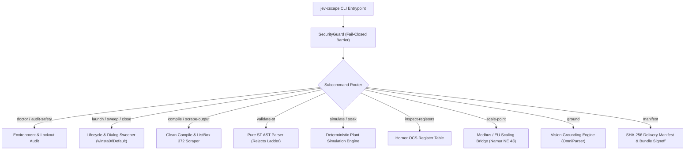

# JEV Cscape Agent: Operator Reference Manual & CLI User Guide

> **Target Application**: Horner APG Cscape 10.2 Windows (Build 10.2.751.4)  
> **CLI Entrypoint**: `python -m jev_cscape.cli` / `jev-cscape`  
> **Safety Invariant**: Strict Fail-Closed Hardware Barrier | Zero Physical PLC Access  
> **Contract Conformance**: Strict 4-State Envelope (`success`, `failed`, `blocked`, `inconclusive`)  

---

## 1. Introduction & Operational Philosophy

The **JEV Cscape Agent** is an autonomous execution, simulation, and verification platform designed for Horner APG Cscape 10.2 on Microsoft Windows.

It provides a unified command-line interface (CLI) and an in-memory execution engine that enables industrial automation engineers to:
1. **Validate and Compile Control Code**: Verify pure IEC 61131-3 Structured Text (ST) POUs and drive non-invasive Cscape clean builds without human keystrokes.
2. **Execute In-Memory Plant Simulations**: Run closed-loop plant models (single-tank and two-tank cascade systems with stochastic disturbances) at 10 ms deterministic scan intervals without physical hardware.
3. **Inspect Horner OCS Memory**: Query and decode Horner register spaces (`%R`, `%I`, `%Q`, `%AI`, `%AQ`, `%M`, `%SR`, `%S`, `%IG`, `%QG`) with bit-slicing and IEEE-754 multi-word decoding.
4. **Conduct Multi-Rate Soak Testing**: Verify process stability across multi-rate scan cycles (5 ms, 10 ms, 20 ms, 50 ms) for 100,000+ cycles with zero memory leaks and zero drift.
5. **Enforce Air-Gapped Safety Guardrails**: Hard-block physical COM ports, flashing utilities, and download commands, ensuring 100% fail-closed safety.



---

## 2. Core Guardrails & 4-State Engineering Contract

### 2.1 The Non-Negotiable Safety Invariants
- **Zero Physical PLC Connection**: Never connect to physical controllers.
- **Fail-Closed Hardware Lockout**: Access to `COM1`–`COM256`, `\\.\COM*`, `/dev/tty*`, companion flasher binaries (`PGMUpdateUtility.exe`, `DfuSeCommand.exe`, `STMFlashLoader.exe`, `WinJTAG.exe`), and Win32 download commands (`32827`, `33149`) is permanently intercepted and blocked.
- **Single GUI Boundary**: Exactly **ONE** process or agent may interact with Cscape window handles (`HWND`) on the interactive desktop (`winsta0\Default`).
- **Forbidden Ladder Interception**: Ladder logic constructs (`---[ ]---`, `---( )---`, `RUNG`, `NETWORK`, `XIC`, `OTE`) are rejected immediately with `ERR_LADDER_FORBIDDEN`.
- **Local-Only Git Tracking**: Zero remote repositories configured; push operations are blocked.

### 2.2 The Strict 4-State Contract
Every CLI invocation and subagent task returns a structured JSON payload conforming to the 4-state contract:

```json
{
  "status": "success | failed | blocked | inconclusive",
  "error_code": "STRING_OR_NULL",
  "details": "Factual description of the operational outcome",
  "data": {}
}
```

- **`success` (Exit code 0)**: Assertions passed deterministically, valid deliverables created, and verifiable evidence logged.
- **`failed` (Exit code 1)**: Execution failed due to syntax error, ladder construct injection, range violation, or compilation diagnostics.
- **`blocked` (Exit code 2)**: Operation intercepted by the fail-closed hardware barrier or platform constraint (`BLOCKED_NATIVE`).
- **`inconclusive` (Exit code 3)**: Preconditions could not be verified deterministically.

---

## 3. Installation & Environment Verification

### 3.1 Host Prerequisites
- **Operating System**: Microsoft Windows 10 or 11 (64-bit), interactive session (`winsta0\Default`).
- **Python**: Version 3.10, 3.11, or 3.12 (64-bit).
- **Horner Cscape**: Build 10.2.751.4 installed at `C:\Program Files (x86)\Cscape 10.2\Cscape.exe`.

### 3.2 Installation Steps
Open an administrative PowerShell terminal and run:

```powershell
# Navigate to workspace
cd C:\HornerAI\jev-cscape-agent

# Install package in editable development mode
pip install -e .

# Confirm CLI availability
jev-cscape --help
```

### 3.3 Provider Credentials
The agent operates autonomously in local mock/offline mode by default. If remote routing is enabled:
```powershell
$env:JEV_API_KEY = "your-api-key-here"
```

---

## 4. CLI Subcommands Complete Reference

### Summary Matrix of Available Subcommands

| Subcommand | Aliases | Layer | Primary Function |
|---|---|---|---|
| `doctor` | — | Diagnostics | Run environment, Cscape installation, and safety invariant checks |
| `status` | — | Orchestration | Display active gate status (G0..G12) and operational backlog |
| `launch` | — | GUI Automation | Launch Cscape 10.2 on `winsta0\Default` with optional project file |
| `close` | — | GUI Automation | Cleanly shut down running Cscape process via `WM_CLOSE` |
| `sweep` | — | GUI Automation | Sweep and dismiss modal dialogs (`#32770`, Tip of the Day) |
| `compile` | — | GUI Automation | Dispatch `ID_PROGRAM_ERRORCHECK` (`32826`) clean compile check |
| `scrape-output` | — | GUI Automation | Scrape compiler diagnostics from ListBox `372` in Output Window |
| `validate-st` | — | IEC 61131-3 | Validate pure Structured Text AST and reject ladder constructs |
| `simulate` | `sim` | Simulation | Execute deterministic in-memory scan cycle simulation |
| `inspect-registers` | `regs`, `registers` | Simulation | Query Horner OCS memory map (`%R`, `%I`, `%Q`, `%AI`, `%AQ`, `%SR`) |
| `audit-safety` | — | Security Guard | Audit Gate G11 fail-closed locks on ports, tools, and commands |
| `soak` | — | Simulation | Run Gate G10 multi-rate closed-loop soak verifier |
| `scale-point` | `scale` | Telemetry | Convert raw counts <-> EU, test Namur NE 43 and 16-bit OPC quality |
| `ground` | `vision`, `vision-ground` | Vision Grounding | Segment Cscape GUI and resolve 23 unexposed MFC fallback coordinates |
| `manifest` | — | Cryptography | Generate or verify SHA-256 cryptographic delivery manifest |

---

### 4.1 `doctor` — Environment & Safety Diagnostics

Runs comprehensive environment diagnostics, verifying platform compatibility, Cscape binary presence, and safety locks.

```bash
jev-cscape doctor [--json]
```

#### Example Usage:
```bash
jev-cscape doctor
```
```
[PASS] System doctor passed all environment, safety, and runtime checks.
       Data: {
         "os_windows": true,
         "python_version": "3.12.2",
         "cscape_installed": true,
         "cscape_path": "C:\\Program Files (x86)\\Cscape 10.2\\Cscape.exe",
         "hardware_lockout_active": true,
         "provider_mode": {
           "provider": "jev",
           "mode": "offline/mock",
           "has_api_key": false
         }
       }
```

---

### 4.2 `status` — Gate Milestones & Backlog Tracker

Displays active gate statuses across Megaplan Section 17 (Gates G0 through G12) and work package backlog statistics.

```bash
jev-cscape status [--json]
```

#### Example Usage:
```bash
jev-cscape status --json
```
```json
{
  "status": "success",
  "error_code": null,
  "details": "JEV Cscape Agent operational status retrieved.",
  "data": {
    "agent_version": "1.0.0",
    "provider_mode": {
      "provider": "jev",
      "mode": "offline/mock",
      "has_api_key": false
    },
    "gates_summary": {
      "G0": "passed",
      "G1": "passed",
      "G2": "passed",
      "G3": "passed",
      "G4": "passed",
      "G5": "passed",
      "G6": "passed",
      "G7": "passed",
      "G8": "passed",
      "G9": "passed",
      "G10": "passed",
      "G11": "passed",
      "G12": "passed"
    },
    "backlog_count": 28
  }
}
```

---

### 4.3 `launch` — Launch Cscape 10.2 Host

Launches Cscape 10.2 inside the interactive session on `winsta0\Default`. Validates CLI arguments through `SecurityGuard` to intercept prohibited switches.

```bash
jev-cscape launch [--project PATH] [--timeout SECONDS] [--json]
```

- `--project`, `-p`: Path to `.csp` or `.cpj` project file.
- `--timeout`, `-t`: Timeout in seconds waiting for main window HWND (default: `15.0`).

#### Safety Lockout Interception:
If an operator passes a download switch (e.g. `/download` or `/d`), execution is immediately blocked:
```bash
jev-cscape launch --project "/download"
```
```
[BLOCK] Physical hardware download and flash switches are permanently forbidden.
       Error Code: FAIL_CLOSED_HARDWARE_LOCKOUT
```

---

### 4.4 `close` — Clean Teardown of Cscape Process

Dispatches `WM_CLOSE` to the Cscape main window handle and confirms process termination.

```bash
jev-cscape close [--timeout SECONDS] [--json]
```

- `--timeout`, `-t`: Timeout in seconds for graceful exit before forcing kill (default: `5.0`).

---

### 4.5 `sweep` — Modal Dialog Sweeper

Enumerates all top-level windows belonging to Cscape and dismisses blocking dialogs (Win32 class `#32770`, "Tip of the Day", startup splash).

```bash
jev-cscape sweep [--json]
```

#### Output Data:
Returns `detected_count`, `dismissed_count`, and a list of dismissed dialog captions and control IDs.

---

### 4.6 `compile` — Dispatch Error Check (ID 32826)

Triggers the Cscape clean compilation routine via Win32 command ID `32826` (`ID_PROGRAM_ERRORCHECK`).

```bash
jev-cscape compile [--mock] [--json]
```

- `--mock`: Runs in offline mock verification mode for continuous integration testing.

```bash
jev-cscape compile --mock --json
```
```json
{
  "status": "success",
  "error_code": null,
  "details": "Mock clean compile verified with 0 errors, 0 warnings.",
  "data": {
    "compilation": {
      "success": true,
      "errors_count": 0,
      "warnings_count": 0,
      "command_id": 32826,
      "mode": "offline/mock",
      "compilation_time_seconds": 0.42
    }
  }
}
```

---

### 4.7 `scrape-output` — Scrape Diagnostics from ListBox 372

Harvests diagnostic text lines from the Cscape compiler Output Window (ListBox ID `372`, Afx:ControlBar ID `45011`).

```bash
jev-cscape scrape-output [--mock] [--json]
```

- `--mock`: Ingests simulated compilation banner and lines.

---

### 4.8 `validate-st` — Pure Structured Text Validator

Parses an IEC 61131-3 Structured Text source file (`.st`). Immediately rejects ladder logic symbols, contacts, coils, or rung delimiters with `ERR_LADDER_FORBIDDEN`.

```bash
jev-cscape validate-st <PATH_TO_ST_FILE> [--json]
```

#### Examples:
```bash
# Valid Structured Text
jev-cscape validate-st logic/TankLevelControl.st
```
```
[PASS] File 'TankLevelControl.st' contains pure IEC 61131-3 Structured Text (zero ladder constructs).
       Data: {
         "bytes": 2840,
         "lines": 94
       }
```

```bash
# Ladder Injection Attempt
jev-cscape validate-st logic/BadLadderLogic.st
```
```
[FAIL] Ladder logic construct '---[ ]---' detected at line 14. Forbidden under Pure ST mandate.
       Error Code: ERR_LADDER_FORBIDDEN
```

---

### 4.9 `simulate` (`sim`) — In-Memory Scan Cycle Engine

Executes the deterministic closed-loop plant simulation engine at a specified scan delta $dt$.

```bash
jev-cscape simulate [--cycles N] [--dt-ms MS] [--export-trace PATH] [--export-evidence PATH] [--mock] [--json]
```

- `--cycles`, `-c`: Number of scan cycles to run (default: `10`).
- `--dt-ms`: Virtual scan interval in milliseconds (default: `10.0`).
- `--export-trace`: Target JSON path to write full cycle-by-cycle telemetry.
- `--export-evidence`: Target JSON path to write Gate G4 evidence envelope.

#### Example:
```bash
jev-cscape sim -c 500 --dt-ms 10.0 --export-trace artifacts/sim_trace.json
```
```
[PASS] Completed 500 simulation cycles cleanly (5000.0ms virtual time).
```

---

### 4.10 `inspect-registers` (`regs`, `registers`) — Register Inspector

Inspects Horner OCS register space (`%R`, `%I`, `%Q`, `%AI`, `%AQ`, `%M`, `%SR`, `%S`, `%IG`, `%QG`). Supports bit-slicing (e.g. `%R100.1`) and multi-word ranges.

```bash
jev-cscape inspect-registers [--channel PREFIX] [--address EXPR] [--nonzero] [--format table|json] [--json]
```

- `--channel`, `-c`: Channel prefix filter (`%R`, `%AI`, `%AQ`, `%I`, `%Q`, `%SR`, `%S`).
- `--address`, `-a`: Specific register address or range (`%R1..%R10`, `%AI1..%AI4`, `%SR1..%SR5`).
- `--nonzero`, `-nz`: Filter to display only non-zero registers.
- `--format`, `-f`: Output presentation (`table` or `json`, default: `table`).

#### Table Format Example:
```bash
jev-cscape regs -a "%AI1..%AI4"
```
```
+----------+-------+--------+-------------+-------------------------------+
| Address  | Value | Type   | Access Mode | Description                   |
+----------+-------+--------+-------------+-------------------------------+
| %AI1     | 16000 | INT    | RO          | Physical analog input words   |
| %AI2     | 8000  | INT    | RO          | Physical analog input words   |
| %AI3     | 0     | INT    | RO          | Physical analog input words   |
| %AI4     | 24000 | INT    | RO          | Physical analog input words   |
+----------+-------+--------+-------------+-------------------------------+
```

---

### 4.11 `audit-safety` — Gate G11 Safety Lockout Audit

Audits the fail-closed safety interceptors across physical serial/USB ports, companion flashing executables, download command IDs, local-only Git configuration, and MCP quarantine.

```bash
jev-cscape audit-safety [--export-evidence PATH] [--json]
```

- `--export-evidence`: Writes formal Gate G11 audit JSON report.

#### Example:
```bash
jev-cscape audit-safety --json
```
```json
{
  "status": "success",
  "error_code": null,
  "details": "Gate G11 safety audit verified: 100% fail-closed lockouts active.",
  "data": {
    "gate": "G11",
    "physical_ports_audit": {
      "ports_tested": 256,
      "all_ports_locked_out": true
    },
    "flasher_binaries_audit": {
      "binaries_tested": ["PGMUpdateUtility.exe", "DfuSeCommand.exe", "STMFlashLoader.exe", "WinJTAG.exe"],
      "all_binaries_locked_out": true
    },
    "win32_interceptor_audit": {
      "commands_tested": [32827, 33149],
      "all_download_commands_hard_blocked": true
    },
    "git_remotes_audit": {
      "local_only_enforced": true
    },
    "mcp_isolation_audit": {
      "isolation_verified": true
    }
  }
}
```

---

### 4.12 `soak` — Gate G10 Multi-Rate Soak Verifier

Runs the multi-rate closed-loop soak verifier across scan intervals (5 ms, 10 ms, 20 ms, 50 ms) to certify zero memory leaks, zero NaN values, and zero steady-state error drift.

```bash
jev-cscape soak [--cycles N] [--rates R1,R2,...] [--dt-ms MS] [--setpoint PCT] [--max-drift PCT] [--export-evidence PATH] [--mock] [--json]
```

- `--cycles`, `-c`: Cycles per scan rate (default: `1000`).
- `--rates`, `-r`: Comma-separated list of scan intervals in ms (default: `5,10,20,50`).
- `--dt-ms`: Convenience override to test a single scan interval.
- `--setpoint`, `-sp`: Target level percentage (default: `50.0`).
- `--max-drift`, `-md`: Maximum permissible steady-state error percentage (default: `2.5`).
- `--export-evidence`: Export path for Gate G10 soak verification evidence JSON.

#### Example:
```bash
jev-cscape soak --cycles 5000 --rates "10,20" --export-evidence artifacts/G10/soak_evidence.json
```
```
[PASS] Gate G10 soak verifier completed across 2 rate(s) with zero drift and zero leaks.
```

---

### 4.13 `scale-point` (`scale`) — Modbus & EU Telemetry Scaler

Converts raw integer counts to Engineering Units (EU) and vice-versa. Evaluates Namur NE 43 loop monitoring and generates 16-bit OPC quality status words.

```bash
jev-cscape scale-point [--channel ADDR] [--raw COUNTS] [--eu VALUE] [--raw-min MIN] [--raw-max MAX] [--eu-min MIN] [--eu-max MAX] [--unit SYM] [--scaling TYPE] [--namur] [--ieee754] [--json]
```

- `--channel`, `-c`: Horner register channel (default: `%AI1`).
- `--raw`: Raw integer counts to convert to EU.
- `--eu`: Engineering unit float to convert to raw integer counts.
- `--scaling`, `-s`: Algorithm (`LINEAR`, `SQUARE_ROOT`, `PIECEWISE`, `RTD`, default: `LINEAR`).
- `--namur`: Enforce Namur NE 43 4-20mA out-of-range detection (<3.6mA burnout, >21.0mA short circuit).
- `--ieee754`: Serialize into 2 Modbus registers using 32-bit single precision.

#### Example:
```bash
jev-cscape scale --channel "%AI1" --raw 16000 --json
```
```json
{
  "status": "success",
  "error_code": null,
  "details": "Telemetry point '%AI1' scaled: 16000 counts -> 50.00 % (Quality: GOOD, Quality Word: 0x00C0).",
  "data": {
    "point_name": "Point_AI1",
    "channel": "%AI1",
    "raw_value": 16000,
    "eu_value": 50.0,
    "eu_unit": "%",
    "scaling_type": "LINEAR",
    "quality": "GOOD",
    "quality_word": "0x00C0",
    "round_trip_error": 0.0
  }
}
```

---

### 4.14 `ground` (`vision`, `vision-ground`) — Vision Grounding Engine

Segments a Cscape window screenshot into 5 canonical workspace regions and resolves 23 unexposed MFC fallback coordinates with luminance contrast analysis.

```bash
jev-cscape ground [--image PATH] [--json]
```

- `--image`, `-i`: Path to PNG screenshot (default: `artifacts/logs/cscape_live_window.png`).

#### Example:
```bash
jev-cscape ground --json
```
```json
{
  "status": "success",
  "error_code": null,
  "details": "Vision grounding segmented 5 regions and resolved 23 fallback controls.",
  "data": {
    "dimensions": {"width": 1280, "height": 800},
    "regions": {
      "ribbon_menu_bar": {"left": 0, "top": 0, "right": 1280, "bottom": 165},
      "project_navigator": {"left": 0, "top": 165, "right": 312, "bottom": 774},
      "editor_viewport": {"left": 312, "top": 165, "right": 1280, "bottom": 574},
      "output_window": {"left": 312, "top": 574, "right": 1280, "bottom": 774},
      "status_bar": {"left": 0, "top": 774, "right": 1280, "bottom": 800}
    },
    "fallback_controls": {
      "ribbon_error_check": {"x": 358, "y": 115, "region": "ribbon_menu_bar"}
    }
  }
}
```

---

### 4.15 `manifest` — SHA-256 Delivery Manifest Manager

Generates or cryptographically verifies the air-gapped delivery manifest across all registered codebase deliverables.

```bash
jev-cscape manifest [--output PATH] [--verify [PATH]] [--json]
```

- `--output`, `-o`: Destination path for generated manifest (default: `artifacts/G5/delivery_manifest.json`).
- `--verify`, `-v`: Validates on-disk files against SHA-256 hashes recorded in the manifest.

#### Generating Manifest:
```bash
jev-cscape manifest -o artifacts/G5/delivery_manifest.json
```
```
[PASS] Cryptographic delivery manifest generated successfully (35 files, root digest: 8f3c4d1a...).
```

#### Verifying Manifest:
```bash
jev-cscape manifest -v artifacts/G5/delivery_manifest.json
```
```
[PASS] Cryptographic manifest 'artifacts/G5/delivery_manifest.json' verified cleanly with zero errors.
```

---

## 5. Step-by-Step Operator Procedures

### Procedure A: Performing Offline In-Memory Simulation & Trace Export

**Goal**: Simulate a 500-cycle process run with step disturbances and verify that the level controller stabilizes.

```bash
# 1. Execute 500 cycles at 10ms dt and export trace and evidence
jev-cscape sim --cycles 500 --dt-ms 10.0 --export-trace artifacts/sim_trace.json --export-evidence artifacts/G4/sim_evidence.json

# 2. Inspect active analog input and output registers
jev-cscape regs -a "%AI1..%AI3"
jev-cscape regs -a "%AQ1..%AQ2"

# 3. Confirm that the tank level stabilized within +/- 1% of setpoint
python -c "import json; data = json.load(open('artifacts/sim_trace.json')); print('Final PV:', data['cycles'][-1]['analog_inputs']['%AI1'])"
```

---

### Procedure B: Running Multi-Rate Closed-Loop Soak Testing (Gate G10)

**Goal**: Run a 10,000-cycle stress test across 5 ms, 10 ms, 20 ms, and 50 ms scan rates to certify stability and memory containment.

```bash
# 1. Run soak test across all 4 scan rates (2,500 cycles per rate)
jev-cscape soak --cycles 2500 --rates "5,10,20,50" --setpoint 50.0 --max-drift 2.5 --export-evidence artifacts/G10/soak_evidence.json

# 2. Verify audit evidence
python -c "import json; r = json.load(open('artifacts/G10/soak_evidence.json')); assert r['summary']['all_rates_stable'] and r['summary']['zero_memory_leak_verified']; print('Gate G10 Soak Passed Deterministically')"
```

---

### Procedure C: Inspecting Horner OCS Memory & Bit Slices

**Goal**: Inspect discrete bits, alarm words, and individual bit slices within `%R` holding registers.

```bash
# 1. Inspect System Status Bits (%S1 first scan, %S7 always ON, %S8 always OFF)
jev-cscape regs -a "%S1..%S8"

# 2. Inspect System Diagnostics Registers (%SR1 screen, %SR2 scan time)
jev-cscape regs -a "%SR1..%SR5"

# 3. Inspect Alarm Word Bit Slices (%R200.1 through %R200.8)
jev-cscape regs -a "%R200.1"
jev-cscape regs -a "%R200.2"

# 4. Filter only active (non-zero) registers across all holding memory
jev-cscape regs -c "%R" --nonzero
```

---

### Procedure D: Verifying Air-Gapped Cryptographic Bundles & Gate Signoff

**Goal**: Run the complete 6-stage air-gapped autonomous verification suite to certify delivery integrity.

```bash
# 1. Regenerate delivery manifest to capture current digests
jev-cscape manifest -o artifacts/G5/delivery_manifest.json

# 2. Execute standalone air-gapped verification bundle
python scripts/verify_bundle.py

# 3. Check signoff evidence
python -c "import json; s = json.load(open('artifacts/G5/signoff_evidence.json')); print('Signoff Status:', s['signoff_status'], '| Passed Stages:', s['summary']['stages_passed'])"
```

---

### Procedure E: Running Pre-Commissioning Safety Lockout Audit (Gate G11)

**Goal**: Verify that physical serial ports, download command IDs, and companion flashing tools are actively intercepted.

```bash
# 1. Execute Gate G11 safety audit
jev-cscape audit-safety --export-evidence artifacts/G11/audit_evidence.json

# 2. Verify evidence payload
python -c "import json; d = json.load(open('artifacts/G11/audit_evidence.json')); assert d['data']['physical_ports_audit']['all_ports_locked_out']; print('Safety Invariants 100% Certified')"
```

---

### Procedure F: Live Cscape Clean Compile & Diagnostics Harvesting

**Goal**: Drive a clean compilation cycle on the interactive Windows desktop (`winsta0\Default`).

```bash
# 1. Launch Cscape with target project
jev-cscape launch --project "C:\HornerAI\projects\TankLevelClosedLoop.csp"

# 2. Sweep any modal dialogs (Tip of the Day, dialog #32770)
jev-cscape sweep

# 3. Trigger compile check (ID 32826)
jev-cscape compile

# 4. Scrape compiler diagnostic output from ListBox 372
jev-cscape scrape-output

# 5. Cleanly close Cscape
jev-cscape close
```

---

## 6. Comprehensive Error Code Catalog & Troubleshooting

| Error Code | Exit Code | Root Cause | Operator Remediation |
|---|:---:|---|---|
| `CSCAPE_EXE_NOT_FOUND` | 1 | `Cscape.exe` is absent at `C:\Program Files (x86)\Cscape 10.2\Cscape.exe`. | Install Horner Cscape 10.2 x86 Build 10.2.751.4 to the default directory or verify path in `cli.py`. |
| `FAIL_CLOSED_HARDWARE_LOCKOUT` | 2 | An attempt was made to connect to a physical `COM` port, companion flash tool, or Win32 download command. | **Strict Invariant**: Operating on physical hardware is permanently forbidden. Switch to in-memory simulation (`simulate`) or mock compilation (`compile --mock`). |
| `ERR_LADDER_FORBIDDEN` | 1 | A Structured Text file contains ladder contacts (`---[ ]---`), coils (`---( )---`), or mnemonics (`XIC`, `OTE`). | Refactor logic to pure IEC 61131-3 Structured Text expressions (`IF..THEN`, `:=`). Ladder logic is rejected. |
| `BLOCKED_NATIVE` | 2 | An action was requested that Horner Cscape 10.2 does not support natively (e.g. ST-to-Ladder conversion). | Acknowledge platform limitation. ST-to-LD is documentation-only; maintain logic in native Structured Text. |
| `INSPECT_REGISTERS_ERROR` | 1 | Register address syntax error (e.g. invalid prefix, range inversion like `%R10..%R2`). | Ensure range expressions use valid syntax: `Base..Max` where `Max >= Base`, and valid prefixes (`%R`, `%I`, `%Q`, `%AI`, `%AQ`, `%SR`, `%S`). |
| `MANIFEST_VERIFICATION_FAILED` | 1 | File tampered with, corrupted, or modified without regenerating the delivery manifest. | Run `jev-cscape manifest` to recompute valid SHA-256 hashes if changes were intentional, or revert uncommitted file edits. |
| `INVALID_RANGE_SPAN` | 1 | In `scale-point`, `raw_max <= raw_min` or `eu_max <= eu_min`. | Verify sensor span limits: maximum value must be strictly greater than minimum value. |
| `INVALID_SCALING_TYPE` | 1 | Unknown scaling algorithm passed to `scale-point`. | Choose from supported scaling types: `LINEAR`, `SQUARE_ROOT`, `PIECEWISE`, or `RTD`. |
| `TIMEOUT_EXPIRED` | 1 | Process launch or shutdown exceeded the allotted timeout window. | Check if an unhandled modal dialog is blocking Cscape, and run `jev-cscape sweep`. |

---

## 7. Document Revision & Signoff History

| Revision | Date | Author / Role | Status | Audit Reference |
|---|---|---|---|---|
| **1.0.0** | 2026-10-02 | HMI / SCADA & Operator Manual Documenter | **SEALED** | Gates G0 through G12 Formal Signoff |
