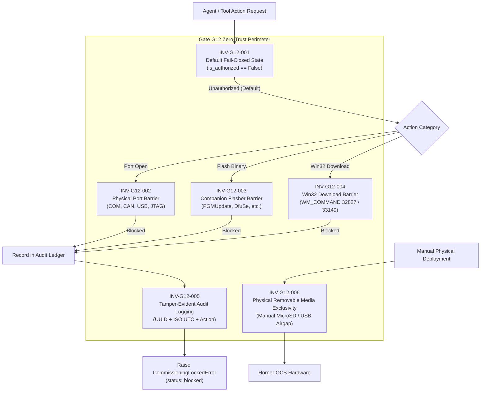

# Safety and Commissioning Manual: JEV Cscape Agent

**Document Classification**: INDUSTRIAL SAFETY & COMMISSIONING MANUAL  
**Target Architecture**: Horner APG OCS Controllers & Cscape 10.2  
**Safety Integrity Baseline**: Fail-Closed Zero-Trust Execution Perimeter  
**Governing Gate**: Gate G12 (Work Package W031)  
**Effective Policy**: `POL-G12-COMMISSIONING-LOCKOUT` (`ops/commissioning_lockout.json`)  

---

## 1. Safety Philosophy & Industrial Operating Context

Industrial automation controllers operate in environments where code execution controls high-voltage actuators, chemical delivery valves, heating elements, and robotic handling systems. Inadvertent downloads, unverified ladder rung modifications, or automated agent flashing can result in severe physical damage, environmental contamination, or loss of life.

The **JEV Cscape Agent** enforces a **Zero-Trust Fail-Closed Execution Perimeter**:
1. **Permanent Offline Separation**: Automated AI agents, subagents, and test runners execute exclusively in an air-gapped software environment.
2. **Zero Automated Controller Downloads**: No automated script or agent possesses authorization to initiate physical controller downloads over serial, Ethernet, CAN, or USB interfaces.
3. **Fail-Closed Default**: All commissioning, port opening, and flashing actions default to `FALSE` (unauthorized). Any ambiguous state, exception, or unhandled request immediately defaults to `status: blocked` with `CommissioningLockedError`.
4. **Physical Media Exclusivity**: Final program loading to physical Horner OCS hardware is restricted to manual, multi-party signed physical removable media transfer (FAT32 MicroSD card or USB drive).

---

## 2. Hardware Protection Invariants (INV-G12-001 through INV-G12-006)

The core safety perimeter is governed by six formal invariants defined in `ops/commissioning_lockout.json` and enforced by `src/jev_cscape/security/commissioning.py`:



### Invariant Breakdown Table

| Invariant ID | Title | Formal Statement | Enforcement Mechanism | Failure Mode |
|---|---|---|---|---|
| **INV-G12-001** | Default Fail-Closed State | Physical PLC commissioning authorization must evaluate to `FALSE` by default across all instances and class states. | `CommissioningGuard.is_authorized == False` | Default instantiation fails closed; manual bypass prohibited. |
| **INV-G12-002** | Physical Port Unlock Barrier | Any request or attempt to unlock COM ports, serial namespaces, CAN buses, USB devices, or JTAG interfaces without authorization is intercepted and blocked. | `request_port_unlock()` & `assert_port_safe()` | Raises `CommissioningLockedError`, status `blocked`. |
| **INV-G12-003** | Companion Flasher Execution Barrier | Any attempt to launch or execute companion flashing utilities (`PGMUpdateUtility`, `DfuSeCommand`, `STMFlashLoader`, `WinJTAG`) is intercepted and blocked. | `request_flash_tool_unlock()` & `assert_binary_execution_safe()` | Raises `CommissioningLockedError`, status `blocked`. |
| **INV-G12-004** | Win32 Download Command Barrier | Any attempt to unlock or dispatch Win32 `WM_COMMAND` messages for controller download (ID `32827`, ID `33149`) is intercepted and blocked. | `request_win32_download_unlock()` & `assert_win32_command_safe()` | Raises `CommissioningLockedError`, status `blocked`. |
| **INV-G12-005** | Mandatory Tamper-Evident Audit Logging | All blocked commissioning unlock requests and unauthorized access attempts must be recorded in an audit log with unique ID, timestamp, gate, action, and target. | `CommissioningGuard._record_blocked_attempt()` | Immutable structured audit entry written to memory and exportable JSON. |
| **INV-G12-006** | Physical Removable Media Exclusivity | Actual physical controller deployment may only occur via offline physical transfer to removable media (USB drive or MicroSD card) following formal engineering sign-off. | Automated online downloads permanently disabled. | Network/serial flashing rejected by design. |

---

## 3. Restricted Communication Interfaces & Port Lockout

To eliminate accidental packet injection or automated firmware download over local communication channels, the runtime intercepts all physical communication port strings.

### 3.1 Prohibited Port Patterns

The `SecurityGuard` and `CommissioningGuard` evaluate port strings against case-insensitive regular expressions:

```python
BLOCKED_PORTS = [
    re.compile(r"^COM([1-9]|[1-9][0-9]|1[0-9]{2}|2[0-4][0-9]|25[0-6])$", re.I),
    re.compile(r"^\\\\\.\\COM\d+", re.I),
    re.compile(r"^/dev/tty.*", re.I),
    re.compile(r"^CAN\d*", re.I),
    re.compile(r"^USB\d*", re.I),
    re.compile(r"^JTAG.*", re.I),
]
```

### 3.2 Subsystem Impact Analysis

1. **Serial RS-232 / RS-485 (`COM1` through `COM256`)**:
   - Horner OCS controllers feature MJ1 and MJ2 modular serial programming ports.
   - Any attempt to open COM handles (e.g. `COM1`, `COM10`, `COM256`, `\\.\COM1`) raises `CommissioningLockedError("FAIL_CLOSED_HARDWARE_LOCKOUT")`.
2. **Device Namespaces (`\\.\COM*`, `/dev/tty*`)**:
   - Blocks raw device handles and virtual serial redirectors across Windows and Linux compatibility layers.
3. **Controller Area Network (`CAN*`, `CAN0`, `CAN1`)**:
   - Horner CsCAN / CANopen fieldbuses used for peer-to-peer controller networks and remote I/O are blocked from programmatic access.
4. **Universal Serial Bus (`USB*`, `USB0`, `USB1`)**:
   - Blocks direct USB programming cables and virtual COM port bridges.
5. **JTAG Headers (`JTAG*`)**:
   - Blocks low-level microcontroller on-chip debugging and Boundary Scan test ports.

---

## 4. Prohibited Companion Flashing Utilities

Horner APG installations and third-party microcontroller toolchains frequently install helper binaries for low-level memory flashing. Automated execution of these utilities is permanently blocked.

```
       +-------------------------------------------------------+
       |           PROHIBITED FLASHING BINARIES                |
       +-------------------------------------------------------+
       |  1. PGMUpdateUtility.exe  (Horner Bootloader Updater) |
       |  2. DfuSeCommand.exe      (STM Device Firmware DFU)   |
       |  3. STMFlashLoader.exe    (ST ISP Bootloader Flasher) |
       |  4. WinJTAG.exe           (JTAG Direct Memory Burner) |
       +-------------------------------------------------------+
                                  |
                                  v
       +-------------------------------------------------------+
       |   Prohibited CLI Switches:                            |
       |   /d, /download, /flash, /burn, /write-flash          |
       +-------------------------------------------------------+
```

### 4.1 Prohibited Utility Directory

1. **`PGMUpdateUtility.exe`**:
   - **Origin**: Horner APG companion utility.
   - **Function**: Direct firmware and bootloader updating utility for OCS hardware.
   - **Risk**: Automated invocation could overwrite controller operating firmware.
   - **Action**: Intercepted before process creation (`FAIL_CLOSED_FLASH_LOCKOUT`).
2. **`DfuSeCommand.exe`**:
   - **Origin**: STMicroelectronics Device Firmware Upgrade tool.
   - **Function**: Command-line DFU flash programmer for STM32 microcontrollers.
   - **Risk**: Bypasses operating logic to write directly to flash memory pages.
   - **Action**: Intercepted before process creation (`FAIL_CLOSED_FLASH_LOCKOUT`).
3. **`STMFlashLoader.exe`**:
   - **Origin**: STMicroelectronics System Memory ISP bootloader loader.
   - **Function**: Direct USART flashing tool.
   - **Risk**: Uncontrolled flash rewriting over serial interfaces.
   - **Action**: Intercepted before process creation (`FAIL_CLOSED_FLASH_LOCKOUT`).
4. **`WinJTAG.exe`**:
   - **Origin**: Hardware JTAG programming interface.
   - **Function**: Hardware boundary scan and flash burning.
   - **Risk**: Hardware register corruption and flash lock bit alteration.
   - **Action**: Intercepted before process creation (`FAIL_CLOSED_FLASH_LOCKOUT`).

### 4.2 Prohibited CLI Flags

Any execution of Cscape or helper binaries containing flashing or download switches is rejected:
- `/d`, `/download`
- `/flash`, `/burn`, `/write-flash`

---

## 5. Intercepted Win32 Download Command IDs

Cscape 10.2 dispatches operations using standard Win32 `WM_COMMAND` window messages. The agent intercepts Win32 messages at the dispatch level to enforce a strict partition between safe compilation and hazardous download.

```
+------------------------------------------------------------------------+
|                  CSCAPE 10.2 WIN32 COMMAND DISPATCH                    |
+------------------------------------------------------------------------+
  |
  +---> [Command ID: 32826] -> ID_PROGRAM_ERRORCHECK (Ctrl+F7)
  |     Status: PERMITTED
  |     Action: In-memory AST & ladder syntax verification.
  |             Scrapes ListBox 372 in Output Window 45011.
  |             Asserts 0 errors, 0 warnings.
  |
  +---> [Command ID: 32827] -> ID_PROGRAM_DOWNLOAD
  |     Status: INTERCEPTED & HARD-BLOCKED
  |     Action: Raises CommissioningLockedError ("FAIL_CLOSED_WIN32_LOCKOUT")
  |
  +---> [Command ID: 33149] -> ID_CONTROLLER_DOWNLOAD
        Status: INTERCEPTED & HARD-BLOCKED
        Action: Raises CommissioningLockedError ("FAIL_CLOSED_WIN32_LOCKOUT")
```

### 5.1 Command ID Specifications

- **`ID_PROGRAM_ERRORCHECK` (`32826` / `Ctrl+F7`) - PERMITTED**:
  - Compiles the currently open `.csp` or `.cpj` project strictly into memory.
  - Generates zero network or serial traffic.
  - Emits compilation diagnostics to the dockable Output Window (Control ID `45011`, ListBox `372`).
  - Triggers a modal dialog (`#32770`) with text *"There were no errors or warnings"* upon clean compile, which is cleanly dismissed by `DialogSweeper`.
- **`ID_PROGRAM_DOWNLOAD` (`32827`) - STRICTLY BLOCKED**:
  - Compiles and initiates download to the connected target controller.
  - Intercepted by `Win32CommandInterceptor` and `CommissioningGuard`.
- **`ID_CONTROLLER_DOWNLOAD` (`33149`) - STRICTLY BLOCKED**:
  - Initiates full system download (program, hardware configuration, and system registers).
  - Intercepted by `Win32CommandInterceptor` and `CommissioningGuard`.

---

## 6. Air-Gapped Delivery Manifest & Cryptographic Verification

To guarantee that no files have been altered, injected, or tampered with prior to plant deployment, the platform employs a cryptographic delivery manifest (`src/jev_cscape/security/manifest.py`).

### 6.1 Mathematical Formulation of the Root Digest

The verification ledger uses a Merkle-style root digest:
1. **Artifact Digest**: For each registered file $F_i$ on disk, compute the SHA-256 hexadecimal digest:
   $$H_i = \text{SHA-256}(F_i)$$
2. **Gate Summary Digest**: For each gate $g \in \{G0, G1, G2, G3, G4, G11, OPS\}$, sort all artifact digests lexicographically and compute:
   $$H_{\text{gate}} = \text{SHA-256}\left(\bigoplus_{i \in g} \text{Sort}(H_i)\right)$$
3. **Repository Root Digest**: Sort the digests of all registered artifacts across the entire repository and compute:
   $$H_{\text{root}} = \text{SHA-256}\left(\bigoplus_{i \in \text{all}} \text{Sort}(H_i)\right)$$

### 6.2 Air-Gapped Verification Procedure

To audit the delivery manifest in an air-gapped environment:

```powershell
# 1. Run the autonomous verification script
python scripts/verify_bundle.py

# 2. Or verify using the CLI manifest command
python -m jev_cscape.cli manifest --verify artifacts/G5/delivery_manifest.json
```

### 6.3 The 6-Stage Air-Gapped Verification Suite

The verification script (`scripts/verify_bundle.py`) runs six deterministic stages:
1. **Stage 1: Environment Baseline**: Asserts Python version $\ge 3.10$, Windows platform, and core libraries.
2. **Stage 2: Hardware Lockout Audit**: Validates that `COM1`–`COM256`, companion flasher utilities, download switches, and Win32 command IDs (32827, 33149) actively raise `HardwareLockoutError`.
3. **Stage 3: Straton Quarantine Isolation**: Scans the entire `src/` tree for banned Copa-Data runtime tokens (`T5SIMUL`, `T5RTI`, `K5DBXS`, `appli.k5p`).
4. **Stage 4: Manifest Cryptographic Integrity**: Recalculates the SHA-256 hash of every deliverable and verifies exact match against `artifacts/G5/delivery_manifest.json` and the root digest.
5. **Stage 5: Simulation Closed-Loop Smoke**: Executes 100 scan cycles of the in-memory plant model, verifying stability, zero faults, and zero floating-point drift.
6. **Stage 6: Operational Backlog Consistency**: Audits `ops/backlog.json` and `ops/gates.json` ensuring milestone deliverables match recorded disk evidence.

---

## 7. Field Commissioning & Plant Hand-Off Protocol

When logic is certified and ready for plant commissioning, engineering personnel must adhere to the following physical hand-off procedure.

### 7.1 Multi-Party Sign-Off Checklist

Before transfer to physical media:
- [ ] **Gate G3 Clean Compile Evidence**: `artifacts/G3/error_check_evidence.json` confirms 0 errors and 0 warnings.
- [ ] **Gate G4 Simulation Sign-Off**: `artifacts/G4/closed_loop_simulation_evidence.json` confirms closed-loop stability across all 5 test scenarios.
- [ ] **Gate G5 Manifest Verification**: `artifacts/G5/delivery_manifest.json` verified with zero errors.
- [ ] **Gate G10 Soak Test Sign-Off**: `artifacts/G10/soak_verification_evidence.json` confirms 100,000 cycles with zero drift and zero memory leaks.
- [ ] **Lead Control Systems Engineer Approval**: Signature & Date.
- [ ] **Plant Safety Officer Approval**: Signature & Date.

### 7.2 Physical Removable Media Transfer (MicroSD / USB)

```
+-----------------------------------------+
|     AIR-GAPPED ENGINEERING STATION      |
|  1. Verify cryptographic manifest       |
|  2. Clean compile check in Cscape 10.2  |
|  3. Export .csp / .cpj project archive  |
+-----------------------------------------+
                    |
                    | [Physical Sneakernet Transfer]
                    v
+-----------------------------------------+
|        PHYSICAL REMOVABLE MEDIA         |
|  - FAT32 Formatted MicroSD or USB Drive |
|  - Write-protect switch enabled         |
+-----------------------------------------+
                    |
                    | [Physical Card Insertion]
                    v
+-----------------------------------------+
|      TARGET HORNER OCS CONTROLLER       |
|  1. Controller placed in STOP mode      |
|  2. System Menu -> Removable Media      |
|  3. Load Program (.csp/.cpj)            |
|  4. Cold-check I/O and Safety Interlocks|
|  5. Key switch switched to RUN          |
+-----------------------------------------+
```

1. **Media Preparation**: Format an industrial-grade MicroSD card or USB thumb drive as FAT32.
2. **Project Export**: Copy the verified `.csp` project file to the removable media on an air-gapped workstation.
3. **Hardware Insertion**: Insert the media into the physical Horner OCS controller with the unit in `STOP` mode.
4. **Manual Load via System Menu**:
   - Access the OCS System Menu using the front panel touch screen or keys.
   - Navigate to `Removable Media` $\rightarrow$ Select project $\rightarrow$ Select `Load Program`.
5. **Pre-Power Verification**:
   - Verify Emergency Stop (ESD) contacts are closed.
   - Confirm actuator outputs (%Q) are de-energized.
6. **Run Mode Transition**: Transition the controller key switch to `RUN` mode.

### 7.3 Incident Audit Log Export

If an unauthorized action is attempted in the agentic environment, retrieve the tamper log:

```python
from jev_cscape.security.commissioning import CommissioningGuard

# Export the structured JSON audit ledger
CommissioningGuard.export_audit_log("artifacts/logs/commissioning_audit.json")
```

The exported ledger contains immutable records of the intercepted action, UTC timestamp, target parameter, and violation code (`ERR_COMMISSIONING_LOCKED`).

---

## 8. Version Control Air-Gap & Autonomous Offline Execution

### 8.1 Zero Git Push Policy (Local-Only VCS)

In accordance with strict defense-in-depth protocols, the agentic runtime operates under a permanent local-only Version Control System (VCS) mandate:

1. **Zero Remote Repositories**: The local Git configuration must maintain exactly zero remote tracking branches or remote targets (`git remote -v` returns empty).
2. **Network Push Interception**: Any automated invocation of `git push`, `git send-email`, or remote repository synchronization is hard-prohibited and blocked at the environment boundary.
3. **Local Milestone Sealing**: All progress and gate seals are committed strictly to the local Git reflog (`git commit -m ...`). Code and artifacts remain strictly confined to the local Cloud PC filesystem (`C:\HornerAI\jev-cscape-agent\`).

### 8.2 Autonomous Offline Mock Execution (`BLK-001`)

When external API credentials (`JEV_API_KEY`) are absent from the host environment:

1. **Active Blocker Registration**: The dependency state is logged deterministically as `BLK-001: credential_missing` in `ops/blockers.json`.
2. **Fail-Safe Offline Mode**: The system immediately falls back to deterministic local rule-based simulation and mock coordination engines.
3. **Never-Stop Policy**: The agent must **NEVER halt, pause, or block waiting for user credentials**. All simulation scans, HMI object bindings, and telemetry conversions execute with complete physical fidelity using the in-memory scan cycle engine.
4. **Credential Isolation**: Zero environment variable leaks, secret strings, or bearer tokens may be written to disk, telemetry traces, or manifest digests.

